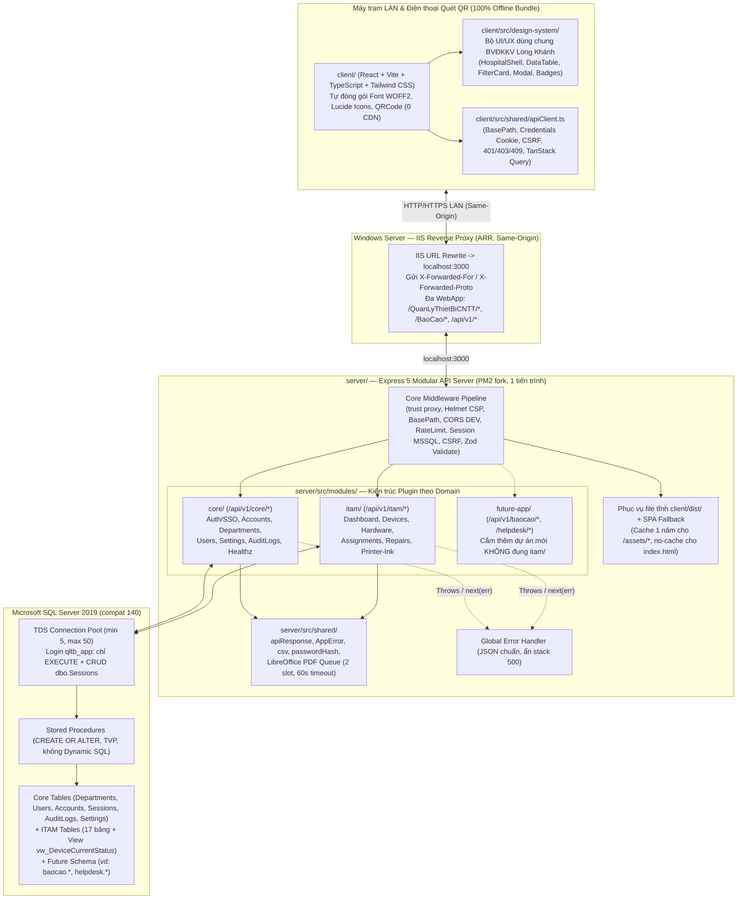

# 2. ARCHITECTURE.md — Kiến trúc Nền tảng API Server & React SPA Đa-WebApp Bệnh viện

> **Dự án:** Hệ thống Quản lý Thiết bị CNTT (`QuanLyThietBiCNTT`) — Khung Nền tảng WebApp Nội bộ BVĐKKV Long Khánh  
> **Quy mô mục tiêu:** 20 → 200 người dùng mạng LAN nội bộ (tải thực tế vài chục request/giây) & mở rộng nhiều WebApp bệnh viện về sau  
> **Phiên bản:** 3.2 (Bổ sung cờ cô lập Profile LibreOffice `-env:UserInstallation=file:///...`, quy trình Graceful Shutdown 15s đóng SQL Pool/PDF Queue, và `<AppErrorBoundary>` + `vite:preloadError` chống trắng trang trên 200 máy trạm LAN khi deploy bản mới)  
> **Cập nhật lần cuối:** 2026-11-20  
> **Xem thay đổi chi tiết tại:** `CHANGELOG.md` mục `[3.0.3-plan]`

---

## 1. Kiến trúc Tổng thể (Modular Platform Architecture)

Hệ thống được thiết kế theo mô hình **Decoupled Frontend (React SPA) + Modular REST API Server (Express 5 ESM) + SQL Server 2019 (Stored Procedure làm trung tâm)**, vận hành **100% trong mạng LAN nội bộ Bệnh viện (Zero External CDN)** sau **IIS Reverse Proxy (ARR)** cùng nguồn (Same-Origin).



---

## 2. Thiết kế API Server Mở rộng cho Nhiều WebApp Bệnh viện (`server/`)

### 2.1 Nguyên tắc Phân ranh giới (Tránh bẫy "Shared Spaghetti")
Để API Server phục vụ tốt `QuanLyThietBiCNTT` hôm nay VÀ dễ dàng mở rộng cho các WebApp bệnh viện sau này (Báo cáo CĐHA/Lâm sàng/TCKT, Helpdesk CNTT, Kho vật tư...):
1. **Phân tầng rõ 2 loại Module trong `server/src/modules/`:**
   - **`core/` (`/api/v1/core/*`) — Lõi Dùng Chung:** chỉ chứa các thực thể mà *mọi* WebApp bệnh viện đều cần: Xác thực/SSO (`auth`), Tài khoản (`accounts`), Khoa/Phòng (`departments`), Nhân sự (`users`), Cấu hình hệ thống (`settings`), Nhật ký kiểm toán (`audit-logs`), và sức khỏe dịch vụ (`/api/v1/healthz`).
   - **`<domain>/` (`/api/v1/itam/*`, sau này `/api/v1/reports/*`, `/api/v1/helpdesk/*`) — Module Nghiệp vụ Độc lập:** mỗi dự án nằm trong 1 thư mục riêng, **không import chéo** trực tiếp giữa các domain module với nhau (chỉ được import từ `shared/` và `modules/core/`).
2. **Định phiên bản API (`/api/v1/`):**
   - Mọi endpoint API đều nằm dưới `/api/v1/<domain>/<resource>`.
   - Tài liệu đặc tả OpenAPI 3.1 lưu tại `server/docs/openapi.yaml` (chỉ bật UI xem thử cục bộ ở `NODE_ENV=development` bằng gói tài nguyên offline).
3. **Hướng dẫn cắm thêm 1 WebApp mới vào API Server (4 bước chuẩn):**
   - Bước 1: Tạo schema/bảng mới trong DB (ưu tiên tách schema riêng vd `helpdesk.*` hoặc DB riêng kết nối pool phụ trong `config/db.js`).
   - Bước 2: Tạo thư mục `server/src/modules/<appCode>/` (gồm `index.js` đăng ký router con + từng feature `routes/validators/controllers/services`).
   - Bước 3: Gắn 1 dòng duy nhất trong `server/src/app.js`: `app.use('/api/v1/<appCode>', <appCode>Router)`.
   - Bước 4: Dùng ngay SSO Auth (`requireAuth`), RBAC (`requireRole`), `auditLogService.log({ appCode: '<appCode>', ... })`, `docxReportService` và `csv.js` có sẵn!

### 2.2 Chiến lược Xác thực, SSO Nội bộ & Adapter Mở rộng
- **Mặc định cho toàn bộ WebApp LAN (Browser SPA):** **Session Cookie `HttpOnly` (`bv_lk.sid`) lưu trên SQL Server `dbo.Sessions` + Double-Check CSRF Token (`X-CSRF-Token`)**.
  - *Ưu điểm vượt trội trong môi trường y tế:* không lưu token vào `localStorage` (miễn nhiễm đánh cắp token qua XSS); Admin bấm Khóa tài khoản / Đổi quyền có hiệu lực **tức thì** (không chờ JWT hết hạn); và hỗ trợ **SSO tự nhiên giữa nhiều WebApp cùng host IIS** chỉ bằng cách đặt `SESSION_COOKIE_PATH=/` trong `.env`!
- **Sẵn sàng cho Mobile App / Tích hợp ngoài trình duyệt về sau:** `middleware/authMiddleware.js` thiết kế theo mẫu **Auth Strategy Adapter** — đọc ngữ cảnh xác thực từ `req.session.user` (mặc định) và có sẵn điểm mở rộng kiểm tra `Authorization: Bearer <token>` mà không cần sửa Controller/Service phía dưới.
- **Định hướng Phân quyền Đa-App (`RBAC`):** hiện tại dùng `Accounts.role` (`admin`, `technician`, `viewer`) cho `itam`; khi gắn WebApp thứ 2 chỉ cần mở rộng bảng `AccountAppRoles(accountId, appCode, role)` theo mô hình Expand-Contract (`DATA-SCHEMA.md` 0.2).

### 2.3 Hiệu năng 20 → 200 CCU, Session, SQL Pool & LibreOffice Queue
- **SQL Pool (`server/src/config/db.js`):** `max: 50, min: 5, idleTimeoutMillis: 30000, acquireTimeoutMillis: 30000`; login `qltb_app` chỉ có `EXECUTE` trên `dbo` + CRUD riêng trên `dbo.Sessions` (không quyền DDL).
- **Session Store (`server/src/shared/sessionStore.js`):** `saveUninitialized: false`, `resave: false`, `rolling: false`; Touch Throttling **5 phút** (bỏ lệnh `CREATE TABLE` khi khởi động vì đã tạo ở `V001`); **không cache RAM** trong `get(sid)`; PM2 chạy **chế độ `fork`, 1 tiến trình**.
- **Cron nội bộ & Graceful Shutdown (`server/src/server.js`):**
  - Cron định kỳ: dọn `Sessions` hết hạn mỗi giờ (xử lý triệt để 4.277 phiên rác hiện hữu); dọn `AuditLogs` > 24 tháng mỗi tháng; dọn file PDF tạm (`cleanupTempReports.js`, chỉ xóa file lẻ quá hạn, giữ nguyên 2 thư mục `lo_profile_1/2`).
  - **Graceful Shutdown (15 giây):** Khi nhận tín hiệu `SIGINT` / `SIGTERM` từ PM2/Windows, server ngừng nhận kết nối HTTP mới (`server.close()`), chờ các request và job PDF đang chạy hoàn tất tối đa `15s`, dừng các `setInterval` cron, và gọi `pool.close()` đóng sạch kết nối SQL Server.
- **Hàng đợi PDF LibreOffice (`server/src/shared/docxReportService.js`):** dùng chung cho cả Sửa chữa (`templates/repairs/`) và Biên bản Bàn giao/Thu hồi (`templates/assignments/`) với cặp thẻ ngoặc kép `delimiters: { start: '{{', end: '}}' }` — `MAX_CONCURRENT_PDF_JOBS = 2`, hàng chờ tối đa `20` (đầy → `429`), timeout `60s`, 2 profile cố định truyền qua cờ **`-env:UserInstallation=file:///<abs_path_forward_slashes>/temp/reports/lo_profile_<1|2>`** (bắt buộc trên Windows để 2 tiến trình `soffice.exe` không khóa chéo `%APPDATA%\LibreOffice`), kill cây tiến trình (`taskkill /PID <pid> /T /F`) nếu quá 60s, dọn file `.docx`/`.pdf` tạm của job ngay trong `finally`.

---

## 3. Thiết kế Frontend SPA (`client/`) — 100% Offline LAN & Tái sử dụng Đa-WebApp

### 3.1 Stack Frontend Chuẩn hóa (Đóng gói 100% Offline vào `client/dist/`)
| Lớp | Công nghệ chọn | Lý do chọn cho môi trường LAN Bệnh viện |
|---|---|---|
| **Core & Build** | **React 19 + TypeScript + Vite 6** | Tốc độ build cực nhanh, kiểm tra lỗi kiểu dữ liệu ngay lúc viết code, hỗ trợ `base: '/QuanLyThietBiCNTT/'` chuẩn cho IIS sub-path. |
| **Routing** | **React Router v7** | `basename={import.meta.env.BASE_URL}`, hỗ trợ deep-link QR `/devices?profileId=<id>` & route guards `<RequireAuth>` / `<RequireRole>`. |
| **Server State** | **TanStack Query v5** | Tự quản lý caching, loading/error state, refetch sau mutation, chống race-condition khi lọc/phân trang nhanh. |
| **Form & Validation** | **React Hook Form + Zod** | Tốc độ gõ mượt trên form nhiều dòng (Quick Config 20 linh kiện), chia sẻ triết lý schema `zod` với Backend. |
| **Styling & Design System** | **Tailwind CSS + CSS Variables (`tokens.css`)** | Biên dịch ra 1 file CSS nội bộ cực nhẹ, dễ khóa cứng bảng màu Y tế BVĐKKV Long Khánh (`#00548F`, `#005A9C`, `#0B8A5C`), hỗ trợ `@media print` sắc nét. |
| **Icons, Fonts & QR (Offline 100%)** | **`lucide-react` + `@fontsource/inter` (hoặc `be-vietnam-pro` WOFF2) + `qrcode`** | **0 request ra Google Fonts / CDN ngoài Internet** — toàn bộ font tiếng Việt, SVG icon và bộ sinh QR biên dịch trực tiếp vào `client/dist/assets/`. |

### 3.2 Tách lớp `design-system/` để Tái sử dụng cho WebApp sau này
Thư mục `client/src/design-system/` được viết **100% không phụ thuộc nghiệp vụ `itam`** (không import bất kỳ type hay API nào của thiết bị CNTT). Khi phòng CNTT làm WebApp thứ 2 (vd: WebApp Báo cáo CĐHA/Lâm sàng/TCKT hoặc Helpdesk), chỉ cần copy/tách package `@bvlk/ui-kit` từ `client/src/design-system/` là có ngay:
- `<HospitalShell>` (Sidebar trái xanh dương `#00548F` + Topbar gạch dọc `#005A9C` + User Card + Footer PCNTT)
- `<DataTable>` (Header xanh đậm `#005A9C`, sticky column, **Empty State căn giữa viewport**, skeleton loading, phân trang chuẩn)
- `<FilterCard>`, `<PageHeader>`, `<Modal>`, `<Drawer>`, `<ConfirmDialog>`, `<ToastProvider>` (`Toast.tsx`), `<StatusBadge>`, `<SearchableSelect>`, `<DateInput>`, `<Pagination>`, `<PrintHeader>`, `<QrLabelPreview>`, `<RequireRole>`, `<AppErrorBoundary>` (chống màn hình trắng trên máy trạm mở tab qua đêm, kết hợp bắt `vite:preloadError` tại `main.tsx` để tự reload mượt khi server cập nhật bản build mới).

### 3.3 Tương thích IIS Sub-path (`/QuanLyThietBiCNTT`) — Chế độ "Linh hoạt Kép" (Dual-Path Tolerant)
1. **Quy tắc Gọi & Định tuyến API thống nhất giữa DEV và Production IIS:**
   - **Tại Frontend (`client/src/shared/apiClient.ts`):** Mọi lời gọi API luôn ghép theo `import.meta.env.BASE_URL` (ví dụ `/QuanLyThietBiCNTT/api/v1/itam/devices`).
   - **Tại Vite Dev Server (`client/vite.config.ts`):** Cấu hình `base: process.env.VITE_BASE_PATH || '/QuanLyThietBiCNTT/'` và khai báo `server.proxy` chấp nhận **cả 2 đường dẫn**:
     - `'/QuanLyThietBiCNTT/api'` → chuyển tiếp sang `http://localhost:3000` (rewrite bỏ tiền tố `/QuanLyThietBiCNTT`).
     - `'/api'` → chuyển tiếp trực tiếp sang `http://localhost:3000`.
   - **Tại Express (`server/src/app.js`):** Middleware `BasePath Stripper` kiểm tra nếu `req.url` bắt đầu bằng `APP_BASE_PATH` (`/QuanLyThietBiCNTT`) thì tự cắt bỏ để đưa về `/api/v1/...` (hoặc `/assets/...`), còn nếu IIS Virtual Application ARR đã cắt sẵn rồi thì giữ nguyên `/api/v1/...`.
   - **Tương thích ngược biến `.env`:** `server/src/config/env.js` đọc `process.env.APP_BASE_PATH ?? process.env.App_Base_Path ?? '/QuanLyThietBiCNTT'` để tương thích 100% với file `.env` hiện có trên máy chủ.
2. **Triển khai Production trên Windows Server + IIS ARR:**
   - Chạy `npm run build` tạo ra gói tĩnh hoàn chỉnh `client/dist/`.
   - Express (`server/src/app.js`) gắn:
     1. `/api/v1/*` → Modular REST API Server.
     2. `express.static('client/dist')` → Phục vụ JS/CSS/Font/Logo (`max-age=31536000, immutable` cho `/assets/*`, `no-cache` cho `index.html`).
     3. SPA History Fallback (`GET /*splat` trừ `/api/*`) → trả `client/dist/index.html` để F5 tại `/QuanLyThietBiCNTT/devices` không bị 404.
   - `web.config` thuần IIS ARR Rewrite `^(.*)$ → http://localhost:3000/{R:1}` bên trong IIS Virtual Application `/QuanLyThietBiCNTT` (bỏ hoàn toàn `iisnode` & `maxConcurrentRequests="1"`).
   - **Lộ trình HTTP → HTTPS:** Giai đoạn 1 chạy HTTP LAN (`COOKIE_SECURE=false`); Giai đoạn 2 gắn chứng chỉ CA nội bộ trên IIS và bật `COOKIE_SECURE=true` (tự bật cờ `Secure` + HSTS, không cần sửa code).
3. **Khi mở rộng đa WebApp trên cùng máy chủ IIS:**
   - IIS có thể giữ nguyên từng Virtual Application (`/QuanLyThietBiCNTT/*`, `/BaoCao/*`) hoặc tách rule `/api/v1/* → localhost:3000/api/v1/*`; đặt `SESSION_COOKIE_PATH=/` để **đăng nhập 1 lần dùng chung mọi WebApp**!

### 3.4 Danh mục Thư viện `npm` Đã Phê duyệt (Approved Dependencies — `npm workspaces`)

Dự án sử dụng **`npm workspaces`** tại `package.json` gốc (`"workspaces": ["server", "client"]`), dùng chung 1 file `package-lock.json` và `node_modules/` ở thư mục gốc. Các gói dưới đây đã được phê duyệt chính thức (AI không cần dừng hỏi mục 0.3 #5 khi cài các gói trong bảng này):

| Workspace | Nhóm | Gói `npm` được phép sử dụng | Mục đích |
|---|---|---|---|
| **Root (`/`)** | `dependencies` (hoặc dùng chung với `server`) | `mssql ^11.0.1`, `dotenv ^17.1.0` *(cùng các gói EJS cũ giữ lại tới khi hoàn tất Cutover Phase 8)* | Phục vụ `scripts/migrate.js` (T0.3), `scripts/seed-admin.js` (T1.2) và tương thích ngược `pre-v3.0`. |
| **`server/`** | `dependencies` | `express ^5.1.0`, `mssql ^11.0.1`, `express-session ^1.18.1`, `dotenv ^17.1.0`, `helmet ^8.x`, `cors ^2.8.x`, `express-rate-limit ^7.x`, `zod ^3.24.x`, `docxtemplater ^3.68.7`, `pizzip ^3.2.0` | REST API Server, SQL Pool, Session Store, Bảo mật CSP/CORS/RateLimit, Validation, Xuất DOCX → PDF. |
| **`server/`** | `devDependencies` / Built-in | `node:test`, `node:assert/strict` (built-in Node 24), `autocannon ^8.x` *(tùy chọn cho `scripts/loadtest/` nếu không dùng script HTTP thuần)* | Kiểm thử Unit/Integration API (`node --test`) & Đo tải 50/100/200 CCU. |
| **`client/`** | `dependencies` | `react ^19.0.0`, `react-dom ^19.0.0`, `react-router ^7.x` (hoặc `react-router-dom ^7.x`), `@tanstack/react-query ^5.x`, `react-hook-form ^7.x`, `@hookform/resolvers ^3.x` (hoặc `^5.x`), `zod ^3.24.x`, `lucide-react`, `qrcode ^1.5.x`, `@fontsource/inter` (hoặc `@fontsource/be-vietnam-pro`), `clsx`, `tailwind-merge` | React SPA 100% Offline LAN, Routing, Server-state cache, Form validation, Icons, QRCode offline, Font WOFF2 nội bộ. |
| **`client/`** | `devDependencies` | `typescript ^5.x`, `vite ^6.x`, `@vitejs/plugin-react`, `tailwindcss ^4.x` (kèm `@tailwindcss/vite`, hoặc `tailwindcss ^3.4.x` + `postcss` + `autoprefixer`), `@types/react`, `@types/react-dom`, `@types/qrcode`, `vitest` | Build, Typecheck (`tsc --noEmit`), biên dịch Tailwind CSS và Unit test tầng `shared/` (`T2.8`). |

---

## 4. Kiến trúc Tính năng Nghiệp vụ Trọng tâm (Giữ trọn v2.6 trên nền v3.0)

- **Quick Config 1 Bước, Clone & Bulk Import CSV:** `POST /api/v1/itam/devices`, `POST /api/v1/itam/devices/import/preview` (Dry-run trả `{ validRows, errorRows }`), `POST /api/v1/itam/devices/import/commit` (1 Transaction + `Idempotency-Key`); Clone 1-Click đọc `GET /api/v1/itam/devices/:id/profile-360` điền sẵn vào Modal Thêm mới.
- **Luân chuyển 1 Bước & Biên bản Bàn giao/Thu hồi PDF:** `POST /api/v1/itam/assignments/:id/transfer` (1 Transaction đóng cũ/mở mới) và `GET /api/v1/itam/assignments/:id/reports/{handover,revoke}/pdf` dùng chung LibreOffice Queue 2 slot.
- **In Tem dán Tài sản kèm Mã QR Offline:** Sinh trực tiếp ở React (`client/src/features/devices/components/QrPrintModal.tsx` kết hợp `client/src/design-system/components/QrLabelPreview.tsx` dùng gói `qrcode` cục bộ), mã QR trỏ `${origin}${BASE_URL}devices?profileId=${device.id}`; mở bằng điện thoại trong LAN tự mở Modal/View Hồ sơ 360° gọn đẹp.
- **Cấu hình Hệ thống Tập trung (`SystemSettings`):** `server/src/modules/core/settings/` có bộ nhớ đệm nhẹ xóa ngay khi Admin bấm Lưu (an toàn với PM2 `fork` 1 tiến trình).
- **Quy trình Migration An toàn:** `db/sql/migrations/Vnnn__*.sql` (idempotent, ghi `SchemaVersions` + SHA-256) và `db/sql/procedures/*.sql` (`CREATE OR ALTER`) chạy qua `scripts/migrate.js` (mặc định khóa cứng chỉ chạy trên `*_DEV`; Production yêu cầu `--prod --backup-confirmed`).

---

## 5. Cấu trúc Thư mục Chuẩn hóa (Target Platform Monorepo — v3.0)

```text
QuanLyThietBiCNTT/
├── package.json                     # Root npm workspaces (["server", "client"]) + scripts tiện ích (dev, build, migrate, test, audit)
├── .env.example                     # Mẫu biến môi trường đầy đủ (0 bí mật thật)
├── web.config                       # IIS ARR Reverse Proxy (bỏ iisnode & maxConcurrentRequests=1)
├── ecosystem.config.cjs             # PM2 (fork, 1 instance), đọc từ .env (0 mật khẩu)
├── AGENTS.md                        # Rule AI tự động nạp mọi phiên
├── CHANGELOG.md
├── .agents/skills/                  # 5 Workspace Skills v3.0 + self-audit.mjs
├── docs/                            # Toàn bộ bộ tài liệu v3.0 + acceptance/PHASE-<N>-REPORT.md
├── scripts/
│   ├── migrate.js                   # Runner migration (guard _DEV / --prod)
│   ├── seed-admin.js                # Tạo tài khoản admin đầu tiên
│   ├── baseline/                    # export-schema.sql, preflight-checks.sql (chỉ đọc)
│   └── loadtest/                    # Kịch bản đo tải 50/100/200 CCU
├── db/
│   └── sql/
│       ├── baseline/                # Bản xuất nguyên trạng DB DEV (chỉ đọc)
│       ├── migrations/              # V001__... đến V008__... (idempotent, bất biến)
│       └── procedures/              # 02_..sql … 08_..sql (CREATE OR ALTER SP/View)
│   └── tests/                       # *.test.sql (ROLLBACK trên DEV)
├── templates/
│   ├── repairs/                     # repair-request-template.docx, repair-inspection-template.docx
│   └── assignments/                 # handover-template.docx, revoke-template.docx
├── server/                          # === EXPRESS 5 MODULAR API SERVER ===
│   ├── package.json
│   ├── docs/openapi.yaml            # Đặc tả OpenAPI 3.1 nội bộ
│   ├── src/
│   │   ├── server.js                # Entrypoint HTTP + graceful shutdown + cron dọn rác
│   │   ├── app.js                   # Express 5 app factory + thứ tự middleware chuẩn
│   │   ├── config/                  # env.js, db.js, session.js, cors.js
│   │   ├── middleware/              # authMiddleware.js, csrfMiddleware.js, rateLimiter.js, validate.js, errorHandler.js
│   │   ├── shared/                  # apiResponse.js, AppError.js, asyncHandler.js, pagination.js, csv.js,
│   │   │                            # passwordHash.js, sessionStore.js, cleanupTempReports.js, docxReportService.js
│   │   └── modules/
│   │       ├── core/                # LÕI DÙNG CHUNG ĐA WEBAPP:
│   │       │   ├── index.js         # Router tổng /api/v1/core
│   │       │   ├── auth/            # routes, validators, controller, service
│   │       │   ├── accounts/
│   │       │   ├── departments/
│   │       │   ├── users/
│   │       │   ├── settings/
│   │       │   ├── audit-logs/
│   │       │   └── health/
│   │       └── itam/                # NGHIỆP VỤ QUẢN LÝ THIẾT BỊ CNTT:
│   │           ├── index.js         # Router tổng /api/v1/itam
│   │           ├── dashboard/
│   │           ├── device-types/
│   │           ├── devices/
│   │           ├── hardware-types/
│   │           ├── hardwares/
│   │           ├── hardware-units/
│   │           ├── device-hardware/
│   │           ├── assignments/     # Gồm cả transfer & handover/revoke PDF
│   │           ├── repairs/         # Gồm cả report-detail & 2 mẫu PDF
│   │           └── printer-ink/     # Phase 7
│   └── tests/                       # Unit & Integration API tests (node --test)
└── client/                          # === REACT + VITE + TYPESCRIPT SPA (100% OFFLINE) ===
    ├── package.json
    ├── vite.config.ts               # base: VITE_BASE_PATH, proxy '/QuanLyThietBiCNTT/api' & '/api' -> localhost:3000
    ├── index.html                   # 0 link CDN ngoài Internet
    └── src/
        ├── main.tsx                 # Nạp font WOFF2 nội bộ + tokens.css + bắt vite:preloadError tự reload + App
        ├── app/                     # App.tsx, router.tsx, providers.tsx, navigation.ts
        ├── design-system/           # BỘ UI/UX DÙNG CHUNG BVĐKKV LONG KHÁNH (tách sạch khỏi itam)
        │   ├── tokens.css           # Bảng màu & token y tế Long Khánh (#00548F, #005A9C, #0B8A5C...)
        │   ├── layout/              # HospitalShell.tsx, Sidebar.tsx, Topbar.tsx
        │   └── components/          # DataTable.tsx, FilterCard.tsx, PageHeader.tsx, Modal.tsx, Drawer.tsx,
        │                            # ConfirmDialog.tsx, StatusBadge.tsx, SearchableSelect.tsx, DateInput.tsx,
        │                            # Pagination.tsx, Toast.tsx, RequireRole.tsx, PrintHeader.tsx,
        │                            # QrLabelPreview.tsx, AppErrorBoundary.tsx
        ├── shared/                  # apiClient.ts, authContext.tsx, formatters.ts, types.ts, qrLabel.ts
        └── features/                # Các màn hình nghiệp vụ ITAM
            ├── auth/                # LoginPage.tsx, ChangePasswordModal.tsx
            ├── admin/               # AccountsPage.tsx, SettingsPage.tsx, AuditLogsPage.tsx
            ├── dashboard/           # DashboardPage.tsx + 4 Tab Báo cáo Đa chiều
            ├── master-data/         # DepartmentsPage.tsx, DeviceTypesPage.tsx
            ├── hardware/            # HardwareHubPage.tsx (4 Tabs)
            ├── devices/             # DevicesPage.tsx, DeviceModal.tsx, Profile360Modal.tsx, BulkImportModal.tsx, QrPrintModal.tsx
            ├── assignments/         # AssignmentsPage.tsx, TransferModal.tsx
            ├── repairs/             # RepairsPage.tsx, RepairModal.tsx, ReportDetailModal.tsx
            └── printer-ink/         # PrinterInkPage.tsx (4 Tabs)
```

> **Ghi chú chuyển tiếp an toàn:** Mã nguồn EJS cũ hiện hữu ở gốc repo được giữ nguyên toàn bộ tại **Git tag `pre-v3.0`**; quá trình xây dựng `server/` và `client/` diễn ra trên nhánh `feature/v3.0` + DB `QuanLyThietBiCNTT_DEV` cho tới khi vượt qua `🔒 GATE 8`.

### 5.1 Đặc tả Toàn bộ Biến Môi trường (`.env.example` & `server/src/config/env.js`)

Mọi biến cấu hình được kiểm tra tại `server/src/config/env.js` (fail-fast ngay khi khởi động nếu thiếu biến bắt buộc):

| Tên biến chuẩn | Bắt buộc? | Giá trị mặc định / Mẫu (`.env.example`) | Mô tả & Quy tắc Tương thích |
|---|---|---|---|
| `NODE_ENV` | Có | `development` (`production` trên server) | Chế độ vận hành (`development` / `test` / `production`). |
| `PORT` | Không | `3000` | Cổng HTTP của Express API Server sau IIS ARR. |
| `APP_BASE_PATH` | Không | `/QuanLyThietBiCNTT` | Sub-path trên IIS. **`env.js` tự động fallback đọc `process.env.App_Base_Path`** nếu file `.env` cũ chưa đổi tên biến. |
| `VITE_BASE_PATH` | Không | `/QuanLyThietBiCNTT/` | Base path khi build React SPA (`vite.config.ts`). Luôn có dấu `/` ở đầu và cuối. |
| `DB_HOST` | **Có (Fail-fast)** | `localhost` *(trong `.env.example` — cấm ghi IP thật)* | Địa chỉ máy chủ SQL Server 2019 (fallback đọc `DB_SERVER` nếu có). |
| `DB_PORT` | Không | `1433` | Cổng TCP SQL Server. |
| `DB_DATABASE` | **Có (Fail-fast)** | `QuanLyThietBiCNTT_DEV` | Tên CSDL. `scripts/migrate.js` chặn cứng nếu không kết thúc bằng `_DEV` (trừ khi có `--prod --backup-confirmed`). |
| `DB_USER` | **Có (Fail-fast)** | `<your_sql_login>` | Tài khoản SQL (`qltb_app` cho runtime API; `qltb_migrator` khi chạy `migrate.js`). |
| `DB_PASSWORD` | **Có (Fail-fast)** | `<your_sql_password>` | Mật khẩu SQL Server. |
| `DB_ENCRYPT` | Không | `false` | Bật mã hóa TLS kết nối SQL nội bộ (`true`/`false`). |
| `DB_POOL_MIN` | Không | `5` | Số kết nối tối thiểu trong TDS Pool. |
| `DB_POOL_MAX` | Không | `50` | Số kết nối tối đa trong TDS Pool (phục vụ 200 CCU). |
| `SESSION_SECRET` | **Có (Fail-fast)** | `<change_me_min_32_chars_random_secret>` | Khóa ký Cookie phiên (`env.js` từ chối khởi động ở `production` nếu thiếu hoặc < 16 ký tự). |
| `SESSION_COOKIE_NAME` | Không | `bv_lk.sid` | Tên cookie SSO nội bộ. |
| `SESSION_COOKIE_PATH` | Không | `/` | Đặt `/` để dùng chung phiên SSO giữa nhiều WebApp trên cùng host IIS. |
| `SESSION_TTL_HOURS` | Không | `8` | Thời hạn phiên đăng nhập (giờ) — khớp ca làm việc 8 tiếng. |
| `COOKIE_SECURE` | Không | `false` | `false` khi chạy HTTP LAN giai đoạn 1; đổi thành `true` khi bật HTTPS CA nội bộ trên IIS. |
| `CORS_ORIGINS` | Không | `http://localhost:5173` | Danh sách Origin cho phép ở DEV (phân cách bằng dấu phẩy). |
| `LIBREOFFICE_PATH` | Không | `C:\Program Files\LibreOffice\program\soffice.exe` | Đường dẫn `soffice.exe` để kết xuất DOCX → PDF. |
| `PDF_MAX_CONCURRENT` | Không | `2` | Số tiến trình LibreOffice chạy song song tối đa (2 slot profile cố định). |
| `PDF_QUEUE_LIMIT` | Không | `20` | Độ dài hàng đợi xuất PDF tối đa (vượt ngưỡng trả HTTP `429`). |
| `PDF_TIMEOUT_MS` | Không | `60000` | Thời gian chờ tối đa 1 job PDF (`60s`) trước khi `taskkill /T /F`. |

---

## 6. Đo lường Hiệu năng (Bắt buộc trước Go-live)
- Kịch bản `autocannon`/`k6` ở mức 50/100/200 kết nối đồng thời tới `/api/v1/*`: p95 < 500 ms, 0 lỗi 5xx, CPU Node < 60%, 0 truy vấn > 1 giây trên `sys.dm_exec_query_stats`, thời gian tải gói React SPA lần đầu trong mạng LAN < 300 ms (và < 20 ms ở các lần sau nhờ cache immutable).
