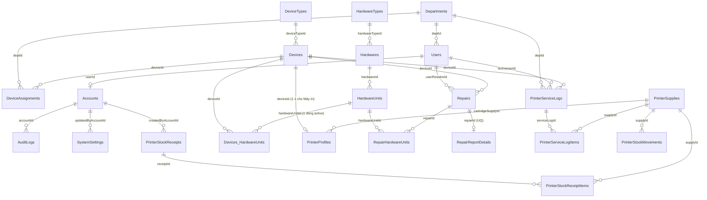

# 3a. DATA-SCHEMA.md — Thiết kế Cơ sở dữ liệu & Chuẩn hóa Stored Procedure

> **Dự án:** Hệ thống Quản lý Thiết bị CNTT (`QuanLyThietBiCNTT`) — Nền tảng CSDL dùng chung đa-WebApp BVĐKKV Long Khánh  
> **Hệ quản trị CSDL:** Microsoft SQL Server 2019 (compatibility level `140` — đã xác minh)  
> **Phiên bản:** 3.2 (Bổ sung SP CRUD `dbo.Users` tự sinh `Id` có `UPDLOCK/HOLDLOCK` cho cột non-IDENTITY; tham số `@pDetachAndDeactivateUnits BIT = 0` trong `sp_Repairs_Update`; kiểm tra khóa ngoại tường minh trong mọi `sp_<Entity>_Delete` thay thế Dynamic SQL `sp_CheckRecordReference`; và chuẩn hóa thẻ `{{placeholder}}` ngoặc kép cho `docxtemplater`)  
> **Cập nhật lần cuối:** 2026-11-20  
> **Xem thay đổi chi tiết tại:** `CHANGELOG.md` mục `[3.0.3-plan]`

---

## 0. Quy ước chung & Phân vùng Đa-WebApp của CSDL

### 0.1 Quy ước Kỹ thuật Cốt lõi
1. **Bảng cũ đồng bộ từ HIS/HR giữ nguyên tên cột:** `Users.Id`, `Users.IsInactive`. Bảng mới và cột mới dùng `camelCase`.
2. **Kiểu thời gian:** giữ `DATETIME`. Lọc theo khoảng ngày luôn viết `col >= @pStart AND col < DATEADD(DAY, 1, @pEnd)`.
3. **Xóa mềm thay cho xóa cứng** với dữ liệu đối soát (phiếu nhập mực, nhật ký bơm mực): `isCanceled`, `canceledAt`, `canceledByAccountId`, `cancelReason`.
4. **Chống ghi đè đồng thời:** `Devices`, `Repairs`, `DeviceAssignments` có `rowVersion ROWVERSION`; lệch thì `THROW 50010` → HTTP `409 CONCURRENT_MODIFICATION`.
5. **Không hard-code ID danh mục hay Phòng CNTT:** dùng cờ `DeviceTypes.isPrinter` cho Máy In và `SystemSettings.it_department_code` (`'PCNTT'`) cho Phòng CNTT thay vì hardcode `deviceTypeId = 1` hay `deptId = 295`.
6. **Mọi SP** tạo bằng `CREATE OR ALTER` kèm `SET ANSI_NULLS ON; SET QUOTED_IDENTIFIER ON;` và đầu thân SP có `SET NOCOUNT ON; SET XACT_ABORT ON;`.
7. **Tham số danh sách** dùng **Table-Valued Parameter (TVP)** (`tt_IdList`, `tt_HardwareItem`, `tt_SupplyQty`), không dùng CSV/JSON.
8. **Tương thích ngược bắt buộc ở Phase 1:** giữ tên SP hiện hữu, tham số mới thêm cuối có mặc định `NULL`, cột mới thêm cuối, `@pRowVersion = NULL` bỏ qua kiểm tra khi app EJS cũ (`pre-v3.0`) gọi.
9. **Không dùng `ON DELETE CASCADE`:** SP xóa phải xóa bản ghi con tường minh trong cùng transaction.

### 0.2 Phân loại Bảng Nền tảng (`Core`) vs Nghiệp vụ (`ITAM`) & Hướng mở rộng Đa-WebApp
Để `server/` dễ dàng mở rộng cho nhiều WebApp bệnh viện sau này mà không làm rối CSDL:
- **Nhóm 1 — Bảng Lõi Nền tảng Dùng chung (`Core Platform` — 7 bảng):** `Departments`, `Users`, `Sessions`, `Accounts`, `AuditLogs` *(thêm `appCode`)*, `SystemSettings` *(thêm `appCode`)*, `SchemaVersions`. Toàn bộ các WebApp nội bộ bệnh viện cùng sử dụng thống nhất danh mục Khoa/Phòng, Nhân sự, SSO Tài khoản, Cấu hình và Nhật ký từ nhóm này.
- **Nhóm 2 — Bảng Nghiệp vụ `ITAM` (17 bảng hiện hữu & mới ở `dbo`):** `DeviceTypes`, `HardwareTypes`, `Hardwares`, `Devices`, `HardwareUnits`, `Devices_HardwareUnits`, `DeviceAssignments`, `Repairs`, `RepairHardwareUnits`, `RepairReportDetails` và 7 bảng `Printer*`.
- **Nhóm 3 — Quy ước mở rộng cho WebApp tương lai (Expand-Contract):**
  - Khi thêm WebApp mới (vd: `baocao`, `helpdesk`, `vattu`): tạo **SQL Schema riêng** (vd `CREATE SCHEMA helpdesk;`) hoặc kết nối Database độc lập cho nghiệp vụ của ứng dụng đó — **không trộn thêm bảng lạ vào schema `dbo` của `itam`**.
  - Khi cần phân quyền khác nhau giữa nhiều WebApp cho cùng 1 tài khoản (vd: `admin` ở `itam`, `viewer` ở `baocao`), chỉ cần mở rộng thêm bảng `dbo.AccountAppRoles(accountId, appCode, role)` mà không phá vỡ cột `Accounts.role` hiện hành.

---

## 1. Sơ đồ Thực thể Liên kết Tổng thể (ER Diagram)



---

## 2. Chi tiết Cấu trúc các Bảng (24 Bảng Tổng cộng)

### 2.1 Nhóm Bảng Lõi Nền tảng Dùng chung Đa-WebApp (`Core Platform` — 7 bảng)

1. **`dbo.Departments`** (41 dòng hiện hữu): `id`, `code VARCHAR(10) UQ`, `name NVARCHAR(200)`, `note NVARCHAR(200) NULL`, `isInactive BIT DEFAULT(0)`.
2. **`dbo.Users`** (11 dòng — toàn bộ thuộc Phòng CNTT `id = 295`, mã `PCNTT`): giữ nguyên cấu trúc (`Id`, `IsInactive`, `deptId`...).
3. **`dbo.Sessions`** (hiện 4.277 dòng hết hạn — dọn sạch ở migration `V001`): `sid VARCHAR(255) PK`, `sess NVARCHAR(MAX)`, `expire DATETIME`.
4. **`dbo.Accounts` (MỚI — `V002`):**
   ```sql
   CREATE TABLE dbo.Accounts (
       id INT IDENTITY(1,1) NOT NULL CONSTRAINT PK_Accounts PRIMARY KEY,
       username VARCHAR(50) NOT NULL CONSTRAINT UQ_Accounts_Username UNIQUE,
       passwordHash VARCHAR(255) NOT NULL,
       fullName NVARCHAR(150) NOT NULL,
       role VARCHAR(20) NOT NULL
           CONSTRAINT CK_Accounts_Role CHECK (role IN ('admin', 'technician', 'viewer')),
       userId INT NULL
           CONSTRAINT FK_Accounts_Users FOREIGN KEY REFERENCES dbo.Users(Id),
       isLocked BIT NOT NULL CONSTRAINT DF_Accounts_IsLocked DEFAULT (0),
       failedLoginAttempts INT NOT NULL CONSTRAINT DF_Accounts_FailedAttempts DEFAULT (0),
       lockedUntil DATETIME NULL,
       mustChangePassword BIT NOT NULL CONSTRAINT DF_Accounts_MustChangePwd DEFAULT (1),
       passwordChangedAt DATETIME NULL,
       lastLoginAt DATETIME NULL,
       createdAt DATETIME NOT NULL CONSTRAINT DF_Accounts_CreatedAt DEFAULT (GETDATE()),
       updatedAt DATETIME NULL
   );
   CREATE UNIQUE NONCLUSTERED INDEX UX_Accounts_UserId
       ON dbo.Accounts(userId) WHERE userId IS NOT NULL;
   ```
5. **`dbo.AuditLogs` (MỚI — `V002`):** *(phân biệt nhật ký giữa các WebApp trên cùng API Server qua `appCode`; cấm lưu mật khẩu/hash/token trong `payloadJson`)*
   ```sql
   CREATE TABLE dbo.AuditLogs (
       id BIGINT IDENTITY(1,1) NOT NULL CONSTRAINT PK_AuditLogs PRIMARY KEY,
       appCode VARCHAR(30) NOT NULL CONSTRAINT DF_AuditLogs_AppCode DEFAULT ('itam'),
       accountId INT NULL
           CONSTRAINT FK_AuditLogs_Accounts FOREIGN KEY REFERENCES dbo.Accounts(id),
       username VARCHAR(50) NULL,
       action VARCHAR(50) NOT NULL,
       entityType VARCHAR(50) NOT NULL,
       entityId VARCHAR(50) NULL,
       summary NVARCHAR(500) NOT NULL,
       payloadJson NVARCHAR(MAX) NULL,
       ipAddress VARCHAR(45) NULL,
       createdAt DATETIME NOT NULL CONSTRAINT DF_AuditLogs_CreatedAt DEFAULT (GETDATE())
   );
   ```
6. **`dbo.SchemaVersions` (MỚI — Bootstrap tự động bởi `scripts/migrate.js` & idempotent trong `V001`):**
   *(Lưu ý: `scripts/migrate.js` luôn chạy lệnh `IF OBJECT_ID(N'dbo.SchemaVersions', N'U') IS NULL CREATE TABLE ...` trước khi duyệt danh sách `V001..V008` để bản thân `V001` được ghi checksum SHA-256 ngay ở lần chạy đầu tiên.)*
   ```sql
   CREATE TABLE dbo.SchemaVersions (
       id INT IDENTITY(1,1) NOT NULL CONSTRAINT PK_SchemaVersions PRIMARY KEY,
       scriptName VARCHAR(200) NOT NULL CONSTRAINT UQ_SchemaVersions_Script UNIQUE,
       checksum CHAR(64) NOT NULL,
       appliedAt DATETIME NOT NULL CONSTRAINT DF_SchemaVersions_AppliedAt DEFAULT (GETDATE()),
       appliedBy NVARCHAR(128) NOT NULL CONSTRAINT DF_SchemaVersions_AppliedBy DEFAULT (SUSER_SNAME())
   );
   ```
7. **`dbo.SystemSettings` (MỚI — `V002` — Cấu hình Hệ thống tập trung cho Admin):**
   ```sql
   CREATE TABLE dbo.SystemSettings (
       settingKey VARCHAR(100) NOT NULL PRIMARY KEY,
       settingValue NVARCHAR(500) NULL,
       appCode VARCHAR(30) NOT NULL DEFAULT ('global'), -- 'global', 'itam', <future-app>
       groupName VARCHAR(50) NOT NULL,                  -- 'organization', 'repair_print', 'printer_ink', 'warranty'
       label NVARCHAR(200) NOT NULL,
       description NVARCHAR(300) NULL,
       valueType VARCHAR(20) NOT NULL DEFAULT ('string')
           CONSTRAINT CK_SystemSettings_Type CHECK (valueType IN ('string', 'int', 'bool')),
       updatedByAccountId INT NULL CONSTRAINT FK_SystemSettings_Accounts FOREIGN KEY REFERENCES dbo.Accounts(id),
       updatedAt DATETIME NULL
   );
   ```
   **Các khóa khởi tạo mặc định (seed idempotent ở `V002`):**
   | `settingKey` | `appCode` | `groupName` | `valueType` | Mặc định | Ý nghĩa |
   |---|---|---|---|---|---|
   | `it_department_code` | `global` | `organization` | `string` | `'PCNTT'` | Mã phòng CNTT (thay hardcode `deptId = 295`) |
   | `default_director_name` | `global` | `repair_print` | `string` | `''` | Tên Giám đốc mặc định trên biểu mẫu in |
   | `default_finance_head_name` | `global` | `repair_print` | `string` | `''` | Tên TP.TC-KT mặc định trên biểu mẫu in |
   | `default_admin_head_name` | `global` | `repair_print` | `string` | `''` | Tên TP.HCQT-TCCB mặc định trên biểu mẫu in |
   | `default_it_rep_name` | `itam` | `repair_print` | `string` | `''` | Tên Đại diện Phòng CNTT mặc định trên biểu mẫu in |
   | `warranty_expiring_days` | `itam` | `warranty` | `int` | `'30'` | Ngưỡng số ngày cảnh báo sắp hết bảo hành |
   | `printer_drum_warn_refills` | `itam` | `printer_ink` | `int` | `'3'` | Ngưỡng cảnh báo số lần bơm mực chưa thay Drum |
   | `printer_cartridge_warn_refills` | `itam` | `printer_ink` | `int` | `'5'` | Ngưỡng cảnh báo số lần bơm mực chưa thay Hộp mực |

---

### 2.2 Nhóm Bảng Danh mục & Tài sản ITAM (6 bảng hiện hữu — nâng cấp)

8. **`dbo.DeviceTypes`** (6 dòng): `id`, `code VARCHAR(10) UQ`, `name NVARCHAR(200)`, `note NVARCHAR(200) NULL`, `isInactive BIT DEFAULT(0)`, **`isPrinter BIT NOT NULL DEFAULT(0)` (`V003` đặt `1` cho `code = 'IN'`)**.
9. **`dbo.HardwareTypes`** (8 dòng): `id`, `code VARCHAR(10) UQ`, `name NVARCHAR(200)`, `note NVARCHAR(200) NULL`, `isInactive BIT DEFAULT(0)`.
10. **`dbo.Hardwares`** (121 dòng): `id`, `code VARCHAR(10) UQ`, `name NVARCHAR(200)`, `hardwareTypeId INT FK`, `note NVARCHAR(200) NULL`, `isInactive BIT DEFAULT(0)`.
11. **`dbo.Devices`** (410 dòng hiện hữu): `id INT IDENTITY PK`, `code VARCHAR(50) UQ`, `name NVARCHAR(200)`, `deviceTypeId INT FK`, `purchaseDate DATETIME`, **`warrantyDate DATETIME NULL` (`V003`)**, `note NVARCHAR(200) NULL`, `isInactive BIT DEFAULT(0)`, **`rowVersion ROWVERSION` (`V003`)**.
12. **`dbo.HardwareUnits`** (2.154 dòng hiện hữu):
    > [!IMPORTANT]
    > **Xử lý dữ liệu hiện có trong Migration `V003` (đã xác minh qua Preflight):**
    > - Làm sạch **`2.153` dòng có `warrantyDate = '1900-01-01'` thành `NULL`**.
    > - DROP Unique Constraint trên `serialNumber` (tra động theo catalog), đổi `serialNumber` sang `VARCHAR(100) NULL`, tạo Filtered Unique Index `UX_HardwareUnits_SerialNumber_NotNull`.
    > - Nới `code` từ `VARCHAR(30)` lên `VARCHAR(60)` (DROP & tái tạo Unique Constraint trong cùng transaction).
    > - Quy tắc tự sinh `code` khi trống: `<DeviceCode>-<HardwareCode>-<STT>` (tính `STT` có `WITH (UPDLOCK, HOLDLOCK)`); nếu > 60 ký tự hoặc không có thiết bị → `LK-<id>`.
13. **`dbo.Devices_HardwareUnits`** (2.123 dòng hiện hữu, 100% active): thêm `attachedDate DATETIME NULL`, `detachedDate DATETIME NULL`; DROP `UQ_Devices_Hardware_Unit` (tra động) → tạo `UX_Devices_HardwareUnits_ActiveUnit (hardwareUnitId) WHERE isInactive = 0`. Cập nhật dùng **thuật toán diff** (giữ nguyên dòng không đổi để bảo toàn `attachedDate`, soft-detach dòng bỏ ra, insert dòng thêm mới).

---

### 2.3 Nhóm Bảng Nghiệp vụ Vòng đời ITAM (4 bảng: 3 hiện hữu + 1 mới)

14. **`dbo.DeviceAssignments`** (415 dòng: 410 active, 5 revoked): giữ nguyên cột hiện hữu + thêm **`rowVersion ROWVERSION`**, tạo `UX_DeviceAssignments_ActiveDevice (deviceId) WHERE isInactive = 0 AND endDate IS NULL`.
15. **`dbo.Repairs`** (0 dòng hiện hữu): giữ nguyên cột hiện hữu (`hardwareUnitId` giữ trạng thái DEPRECATED để tương thích) + thêm **`rowVersion ROWVERSION`**, `CK_Repairs_Status ('opened','in-progress','completed','canceled')`, `FK_Repairs_Users`.
16. **`dbo.RepairHardwareUnits` (MỚI — `V004`):** *(Không `ON DELETE CASCADE` — xóa tường minh trong `sp_Repairs_Delete`/`sp_Repairs_Update`)*
    ```sql
    CREATE TABLE dbo.RepairHardwareUnits (
        id INT IDENTITY(1,1) NOT NULL CONSTRAINT PK_RepairHardwareUnits PRIMARY KEY,
        repairId INT NOT NULL
            CONSTRAINT FK_RepairHardwareUnits_Repairs FOREIGN KEY REFERENCES dbo.Repairs(id),
        hardwareUnitId INT NOT NULL
            CONSTRAINT FK_RepairHardwareUnits_HardwareUnits FOREIGN KEY REFERENCES dbo.HardwareUnits(id),
        CONSTRAINT UQ_RepairHardwareUnits_Pair UNIQUE (repairId, hardwareUnitId)
    );
    ```
17. **`dbo.RepairReportDetails`** (0 dòng hiện hữu): giữ nguyên 33 cột thật (`AS-IS-BASELINE.md` 2.1). Báo cáo dùng `COALESCE(actualRepairHours, expectedRepairHours)` và `estimatedCost`.

---

### 2.4 Nhóm Bảng Máy in, Phiếu nhập Mực & Nhật ký Bơm mực (7 bảng — DDL `V006`, SP & UI Phase 7)

> **Quy tắc chung cho 7 bảng Máy in & Mực:** Tuyệt đối không dùng `ON DELETE CASCADE`. Mọi biến động tồn kho chỉ đi qua SP giao dịch ghi đồng thời vào `PrinterStockMovements` và cập nhật tương đối `PrinterSupplies.stockQuantity = stockQuantity + @delta`.

18. **`dbo.PrinterSupplies` (Danh mục vật tư mực/linh kiện máy in):**
    ```sql
    CREATE TABLE dbo.PrinterSupplies (
        id INT IDENTITY(1,1) NOT NULL CONSTRAINT PK_PrinterSupplies PRIMARY KEY,
        code VARCHAR(30) NOT NULL CONSTRAINT UQ_PrinterSupplies_Code UNIQUE,
        name NVARCHAR(200) NOT NULL,
        supplyType VARCHAR(30) NOT NULL
            CONSTRAINT CK_PrinterSupplies_Type CHECK (supplyType IN ('toner', 'cartridge', 'drum', 'fuser', 'roller', 'other')),
        unit NVARCHAR(30) NOT NULL CONSTRAINT DF_PrinterSupplies_Unit DEFAULT (N'Cái'),
        compatibleModels NVARCHAR(300) NULL,
        stockQuantity INT NOT NULL CONSTRAINT DF_PrinterSupplies_Stock DEFAULT (0), -- Cache sổ cái, CHO PHÉP ÂM
        minStockThreshold INT NOT NULL CONSTRAINT DF_PrinterSupplies_MinStock DEFAULT (2),
        note NVARCHAR(200) NULL,
        isInactive BIT NOT NULL CONSTRAINT DF_PrinterSupplies_IsInactive DEFAULT (0),
        createdAt DATETIME NOT NULL CONSTRAINT DF_PrinterSupplies_CreatedAt DEFAULT (GETDATE())
    );
    ```
19. **`dbo.PrinterStockReceipts` (Phiếu nhập kho vật tư mực):**
    ```sql
    CREATE TABLE dbo.PrinterStockReceipts (
        id INT IDENTITY(1,1) NOT NULL CONSTRAINT PK_PrinterStockReceipts PRIMARY KEY,
        receiptCode VARCHAR(50) NOT NULL,
        receiptDate DATETIME NOT NULL,
        supplierOrSource NVARCHAR(200) NULL,
        note NVARCHAR(300) NULL,
        createdByAccountId INT NOT NULL
            CONSTRAINT FK_PrinterStockReceipts_CreatedBy FOREIGN KEY REFERENCES dbo.Accounts(id),
        createdAt DATETIME NOT NULL CONSTRAINT DF_PrinterStockReceipts_CreatedAt DEFAULT (GETDATE()),
        isCanceled BIT NOT NULL CONSTRAINT DF_PrinterStockReceipts_IsCanceled DEFAULT (0),
        canceledAt DATETIME NULL,
        canceledByAccountId INT NULL
            CONSTRAINT FK_PrinterStockReceipts_CanceledBy FOREIGN KEY REFERENCES dbo.Accounts(id),
        cancelReason NVARCHAR(300) NULL
    );
    CREATE UNIQUE NONCLUSTERED INDEX UX_PrinterStockReceipts_Code_Active
        ON dbo.PrinterStockReceipts(receiptCode) WHERE isCanceled = 0;
    ```
20. **`dbo.PrinterStockReceiptItems` (Chi tiết dòng phiếu nhập mực):**
    ```sql
    CREATE TABLE dbo.PrinterStockReceiptItems (
        id INT IDENTITY(1,1) NOT NULL CONSTRAINT PK_PrinterStockReceiptItems PRIMARY KEY,
        receiptId INT NOT NULL
            CONSTRAINT FK_PrinterStockReceiptItems_Receipts FOREIGN KEY REFERENCES dbo.PrinterStockReceipts(id),
        supplyId INT NOT NULL
            CONSTRAINT FK_PrinterStockReceiptItems_Supplies FOREIGN KEY REFERENCES dbo.PrinterSupplies(id),
        quantity INT NOT NULL CONSTRAINT CK_PrinterStockReceiptItems_Qty CHECK (quantity > 0),
        note NVARCHAR(200) NULL
    );
    ```
21. **`dbo.PrinterStockMovements` (Sổ cái biến động tồn kho mực bất biến):**
    ```sql
    CREATE TABLE dbo.PrinterStockMovements (
        id BIGINT IDENTITY(1,1) NOT NULL CONSTRAINT PK_PrinterStockMovements PRIMARY KEY,
        supplyId INT NOT NULL
            CONSTRAINT FK_PrinterStockMovements_Supplies FOREIGN KEY REFERENCES dbo.PrinterSupplies(id),
        movementType VARCHAR(30) NOT NULL
            CONSTRAINT CK_PrinterStockMovements_Type CHECK (movementType IN ('receipt', 'service_out', 'cancel_receipt', 'cancel_service', 'adjust')),
        quantityDelta INT NOT NULL,
        refType VARCHAR(30) NOT NULL
            CONSTRAINT CK_PrinterStockMovements_RefType CHECK (refType IN ('receipt', 'service_log', 'manual')),
        refId INT NULL,
        note NVARCHAR(300) NULL,
        createdByAccountId INT NOT NULL
            CONSTRAINT FK_PrinterStockMovements_Accounts FOREIGN KEY REFERENCES dbo.Accounts(id),
        createdAt DATETIME NOT NULL CONSTRAINT DF_PrinterStockMovements_CreatedAt DEFAULT (GETDATE())
    );
    ```
22. **`dbo.PrinterProfiles` (Hồ sơ kỹ thuật mở rộng 1-1 cho thiết bị là Máy in):**
    ```sql
    CREATE TABLE dbo.PrinterProfiles (
        deviceId INT NOT NULL CONSTRAINT PK_PrinterProfiles PRIMARY KEY
            CONSTRAINT FK_PrinterProfiles_Devices FOREIGN KEY REFERENCES dbo.Devices(id),
        cartridgeSupplyId INT NULL
            CONSTRAINT FK_PrinterProfiles_Supplies FOREIGN KEY REFERENCES dbo.PrinterSupplies(id),
        ipAddress VARCHAR(45) NULL,
        connectionType VARCHAR(20) NOT NULL CONSTRAINT DF_PrinterProfiles_Conn DEFAULT ('LAN')
            CONSTRAINT CK_PrinterProfiles_Conn CHECK (connectionType IN ('LAN', 'USB', 'WIFI', 'SHARED')),
        refillCountSinceNewCartridge INT NOT NULL CONSTRAINT DF_PrinterProfiles_RefillCart DEFAULT (0),
        refillCountSinceNewDrum INT NOT NULL CONSTRAINT DF_PrinterProfiles_RefillDrum DEFAULT (0),
        lastRefillDate DATETIME NULL,
        lastDrumReplaceDate DATETIME NULL,
        lastCartridgeReplaceDate DATETIME NULL,
        note NVARCHAR(200) NULL,
        updatedAt DATETIME NULL
    );
    ```
23. **`dbo.PrinterServiceLogs` (Nhật ký bơm mực / thay Drum / thay hộp mực / bảo trì):**
    ```sql
    CREATE TABLE dbo.PrinterServiceLogs (
        id INT IDENTITY(1,1) NOT NULL CONSTRAINT PK_PrinterServiceLogs PRIMARY KEY,
        deviceId INT NOT NULL
            CONSTRAINT FK_PrinterServiceLogs_Devices FOREIGN KEY REFERENCES dbo.Devices(id),
        deptId INT NOT NULL
            CONSTRAINT FK_PrinterServiceLogs_Departments FOREIGN KEY REFERENCES dbo.Departments(id),
        serviceDate DATETIME NOT NULL,
        actionType VARCHAR(30) NOT NULL
            CONSTRAINT CK_PrinterServiceLogs_Action CHECK (actionType IN ('refill', 'replace_cartridge', 'replace_drum', 'replace_part', 'maintenance')),
        pageCounter INT NULL,
        senderName NVARCHAR(100) NULL,
        technicianId INT NULL
            CONSTRAINT FK_PrinterServiceLogs_Users FOREIGN KEY REFERENCES dbo.Users(Id),
        note NVARCHAR(300) NULL,
        createdByAccountId INT NOT NULL
            CONSTRAINT FK_PrinterServiceLogs_CreatedBy FOREIGN KEY REFERENCES dbo.Accounts(id),
        createdAt DATETIME NOT NULL CONSTRAINT DF_PrinterServiceLogs_CreatedAt DEFAULT (GETDATE()),
        isCanceled BIT NOT NULL CONSTRAINT DF_PrinterServiceLogs_IsCanceled DEFAULT (0),
        canceledAt DATETIME NULL,
        canceledByAccountId INT NULL
            CONSTRAINT FK_PrinterServiceLogs_CanceledBy FOREIGN KEY REFERENCES dbo.Accounts(id),
        cancelReason NVARCHAR(300) NULL
    );
    ```
24. **`dbo.PrinterServiceLogItems` (Vật tư tiêu hao thực tế của mỗi lượt dịch vụ máy in):**
    ```sql
    CREATE TABLE dbo.PrinterServiceLogItems (
        id INT IDENTITY(1,1) NOT NULL CONSTRAINT PK_PrinterServiceLogItems PRIMARY KEY,
        serviceLogId INT NOT NULL
            CONSTRAINT FK_PrinterServiceLogItems_Logs FOREIGN KEY REFERENCES dbo.PrinterServiceLogs(id),
        supplyId INT NOT NULL
            CONSTRAINT FK_PrinterServiceLogItems_Supplies FOREIGN KEY REFERENCES dbo.PrinterSupplies(id),
        quantity INT NOT NULL CONSTRAINT CK_PrinterServiceLogItems_Qty CHECK (quantity > 0)
    );
    ```

---

### 2.5 Table Types (`V001`) & View Trạng thái (`vw_DeviceCurrentStatus`)
- **Table Types (`V001`):**
  ```sql
  CREATE TYPE dbo.tt_IdList AS TABLE (
      id INT NOT NULL PRIMARY KEY
  );
  CREATE TYPE dbo.tt_HardwareItem AS TABLE (
      hardwareId INT NOT NULL PRIMARY KEY,
      qty INT NOT NULL CHECK (qty BETWEEN 1 AND 20)
  );
  CREATE TYPE dbo.tt_SupplyQty AS TABLE (
      supplyId INT NOT NULL PRIMARY KEY,
      quantity INT NOT NULL CHECK (quantity > 0),
      note NVARCHAR(200) NULL
  );
  ```
- **View `dbo.vw_DeviceCurrentStatus`:** suy ra `usageStatus` (`inactive` > `under_repair` > `in_use` > `in_stock`), `currentDeptId`, `currentDeptName`, `isUnderRepair`, kèm `warrantyStatus` (`'none'`, `'valid'`, `'expiring'`, `'expired'` dựa trên `Devices.warrantyDate` và `SystemSettings.warranty_expiring_days`).

---

## 3. Chiến lược Đánh chỉ mục (Indexes)
- **Filtered Unique Indexes:** `UX_HardwareUnits_SerialNumber_NotNull`, `UX_DeviceAssignments_ActiveDevice`, `UX_Devices_HardwareUnits_ActiveUnit`, `UX_Accounts_UserId`, `UX_PrinterStockReceipts_Code_Active`.
- **Non-Clustered Indexes:** đầy đủ trên các cột FK, trạng thái và ngày (`Devices`, `Hardwares`, `HardwareUnits`, `Devices_HardwareUnits`, `DeviceAssignments`, `Repairs`, `RepairHardwareUnits`, `Sessions`, `AuditLogs(appCode, createdAt DESC)`, `PrinterServiceLogs`, `PrinterStockMovements`).

---

## 4. Danh mục Stored Procedures (Trọng tâm v3.0)

> Giữ nguyên toàn bộ nguyên tắc tương thích ngược Phase 1 (giữ tên SP hiện hữu, tham số mới thêm cuối mặc định `NULL`, cột mới thêm cuối, `@pRowVersion = NULL` bỏ qua kiểm tra khi app EJS cũ `pre-v3.0` gọi).

| Nhóm | Tên SP | Đặc tả chi tiết |
|---|---|---|
| **Core Platform** | `sp_Auth_*`, `sp_Accounts_*`, `sp_SystemSettings_GetAll/Upsert`, `sp_AuditLogs_Create/GetPaged/Purge`, `sp_Departments_*`, `sp_Users_GetPaged/GetDropdown/Create/Update/ToggleStatus` | `sp_AuditLogs_Create/GetPaged` hỗ trợ `@pAppCode` (mặc định `'itam'`); `sp_SystemSettings_GetAll` hỗ trợ lọc `@pAppCode NULL`; `sp_Users_Create` hỗ trợ truyền `@pId INT = NULL` (từ HIS) hoặc tự sinh `SELECT @newId = ISNULL(MAX(Id), 0) + 1 FROM dbo.Users WITH (UPDLOCK, HOLDLOCK)` vì `Users.Id` không có `IDENTITY`. |
| **Thiết bị Quick Config** | `sp_Devices_GetPaged`, `sp_Devices_GetProfile360`, `sp_Devices_SaveWithQuickConfig`, `sp_Devices_Delete` | `SaveWithQuickConfig` nhận `@pWarrantyDate`, TVP `tt_HardwareItem`, chỉ bổ sung không tự gỡ, sinh mã có `UPDLOCK/HOLDLOCK`, kiểm `rowVersion`; mọi SP `sp_<Entity>_Delete` kiểm tra trực tiếp `IF EXISTS (...) THROW 50009` trên cả bảng cũ lẫn bảng mới (`Devices_HardwareUnits`, `DeviceAssignments`, `Repairs`, `PrinterProfiles`, `PrinterServiceLogs`...) thay thế hoàn toàn Dynamic SQL `sp_CheckRecordReference`. |
| **Linh kiện Diff** | `sp_HardwareUnits_*`, `sp_DeviceHardwareUnits_UpdateAssigned`, `_Detach` | Thuật toán diff bảo toàn `attachedDate` dòng không đổi; soft-detach chặn gỡ ở màn hình linh kiện khi đang nằm trong phiếu sửa mở (`50009`); `sp_HardwareUnits_Delete` kiểm tra ràng buộc trên cả `Devices_HardwareUnits`, `Repairs` và `RepairHardwareUnits`. |
| **Bàn giao / Luân chuyển** | `sp_DeviceAssignments_Transfer`, `sp_DeviceAssignments_GetPrintDataById` | `Transfer`: 1 Transaction kiểm `rowVersion`, đóng cũ (`endDate = @pTransferDate, isInactive = 1`), mở mới sang `@pNewDeptId`; `GetPrintDataById`: nối cấu hình linh kiện bằng `STRING_AGG` + người ký mặc định từ `SystemSettings`. |
| **Sửa chữa & In PDF** | `sp_Repairs_Create/Update/Delete`, `sp_Repairs_GetPrintDataById`, `sp_RepairReportDetails_GetSurveyUsers` | Hỗ trợ TVP nhiều linh kiện (`RepairHardwareUnits`); **`sp_Repairs_Update` có tham số cuối `@pDetachAndDeactivateUnits BIT = 0`** (khi `= 1` và `@pStatus = 'completed'`, tự động soft-detach các linh kiện trong phiếu khỏi `Devices_HardwareUnits` và đặt `HardwareUnits.isInactive = 1` trong cùng 1 Transaction); `GetPrintDataById` lấy Khoa/Phòng theo `brokenDate` qua `OUTER APPLY` & gộp linh kiện bằng `STRING_AGG`; `GetSurveyUsers` tra phòng theo `SystemSettings.it_department_code`. |
| **Dashboard & Máy in** | `sp_Dashboard_GetSummary`, `sp_Reports_*`, `sp_Printers_*`, `sp_PrinterSupplies_*`, `sp_PrinterStockReceipts_*`, `sp_PrinterServiceLogs_*` | Đọc ngưỡng cảnh báo từ `SystemSettings`; sổ cái `PrinterStockMovements` cho phép tồn âm & hủy mềm; bộ đếm bơm mực tính lại từ nhật ký. |

### 4.1 Bảng Ánh xạ Thứ tự `recordsets[]` của Toàn bộ Stored Procedures Phân trang (`G2` — Bắt buộc tuân thủ)

Để bảo đảm **100% tương thích ngược với code EJS cũ (`pre-v3.0`)** ở Phase 1 đồng thời chuẩn hóa `server/` v3.0 không bao giờ đọc nhầm thứ tự `recordsets`:

| Nhóm SP phân trang | Danh sách Stored Procedure | `recordsets[0]` | `recordsets[1]` | Lý do |
|---|---|---|---|---|
| **Nhóm A — 7 SP hiện hữu giữ thứ tự cũ** | `sp_Departments_GetPaged`, `sp_DeviceTypes_GetAll`, `sp_Devices_GetPaged`, `sp_HardwareTypes_GetAll`, `sp_Hardwares_GetAll`, `sp_HardwareUnits_GetAll`, `sp_DeviceHardwareUnits_GetDevicesWithHardware_Paged` | `[{ total }]` *(1 dòng đếm tổng)* | `data` *(danh sách bản ghi)* | Giữ nguyên để `services/*.js` của bản EJS cũ (`pre-v3.0`) chạy không lỗi ở `🔒 GATE 1B` (`NFR-08`). |
| **Nhóm B — 2 SP hiện hữu đã theo chuẩn mới** | `sp_DeviceAssignments_Get_Paged`, `sp_Repairs_GetAll_Paged` | `data` *(danh sách bản ghi)* | `[{ total }]` *(1 dòng đếm tổng)* | Đã được chuẩn hóa từ đợt v1.1 (`deviceAssignmentService.js`, `repairService.js`). |
| **Nhóm C — Toàn bộ SP phân trang mới v3.0** | `sp_Users_GetPaged`, `sp_Accounts_GetPaged`, `sp_AuditLogs_GetPaged`, `sp_Printers_GetPaged`, `sp_PrinterSupplies_GetPaged`, `sp_PrinterStockReceipts_GetPaged`, `sp_PrinterServiceLogs_GetPaged` | `data` *(danh sách bản ghi)* | `[{ totalItems }]` *(1 dòng đếm tổng)* | Chuẩn thống nhất v3.0 (`PROJECT-RULES.md` Mục 3.2). |

> **Helper chuẩn hóa tại `server/src/shared/pagination.js` (`T2.3`):**
> Hàm `extractPagedRecordsets(result)` trong `server/src/shared/pagination.js` tự động nhận diện cả 2 thứ tự (kiểm tra recordset nào có đúng 1 phần tử mang khóa chỉ chứa `total` / `totalItems` / `totalCount` vs recordset chứa các dòng dữ liệu, hoặc truyền cờ tường minh) để trả về `{ items, totalItems }` thống nhất cho toàn bộ `server/src/modules/*`.

### 4.2 Hợp đồng Cột Dữ liệu In PDF (`{{placeholder}}` ngoặc kép cho `docxtemplater`)

> **Quy ước `delimiters` bắt buộc (`services/docxReportService.js`):** Toàn bộ file mẫu Word trong `templates/repairs/` và `templates/assignments/` thống nhất dùng cặp dấu ngoặc nhọn kép **`{{tag}}`** (`delimiters: { start: '{{', end: '}}' }`).

1. **Biên bản Bàn giao & Thu hồi (`sp_DeviceAssignments_GetPrintDataById` → `templates/assignments/handover-template.docx` & `revoke-template.docx`):**
   - Các cột SP trả về (khớp 1-1 với thẻ `{{tag}}` trong file Word):
     - Thông tin phiếu & ngày in: `{{assignmentId}}`, `{{handoverDate}}` (`dd/MM/yyyy`), `{{revokeDate}}` (`dd/MM/yyyy` hoặc `''`), `{{day}}`, `{{month}}`, `{{year}}`, `{{note}}`.
     - Thông tin thiết bị & cấu hình: `{{deviceCode}}`, `{{deviceName}}`, `{{deviceTypeName}}`, `{{purchaseDate}}` (`dd/MM/yyyy`), `{{warrantyDate}}` (`dd/MM/yyyy` hoặc `'Không có'`), `{{hardwareSummary}}` (chuỗi nối các linh kiện đang gắn bằng `STRING_AGG(CONCAT(h.name, N' (', hu.code, N')'), N', ')`).
     - Thông tin đơn vị & người ký: `{{fromDeptCode}}`, `{{fromDeptName}}` (mặc định `'Phòng Công Nghệ Thông Tin'` khi bàn giao từ kho), `{{toDeptCode}}`, `{{toDeptName}}` (Khoa/Phòng nhận hoặc trả), `{{itRepName}}` (từ `SystemSettings.default_it_rep_name`), `{{deptRepName}}` (`''` để ký tay hoặc truyền từ query), `{{adminHeadName}}` (`SystemSettings.default_admin_head_name`), `{{directorName}}` (`SystemSettings.default_director_name`).
2. **Phiếu Đề nghị & Biên bản Kiểm tra Sửa chữa (`sp_Repairs_GetPrintDataById` → `templates/repairs/*.docx`):**
   - Giữ nguyên 100% các trường `{{tag}}` hiện có của 2 mẫu Word trong `templates/repairs/`, đồng thời sửa truy vấn lấy Khoa/Phòng theo `brokenDate` bằng `OUTER APPLY` và gộp danh sách nhiều linh kiện từ `RepairHardwareUnits` bằng `STRING_AGG`.
