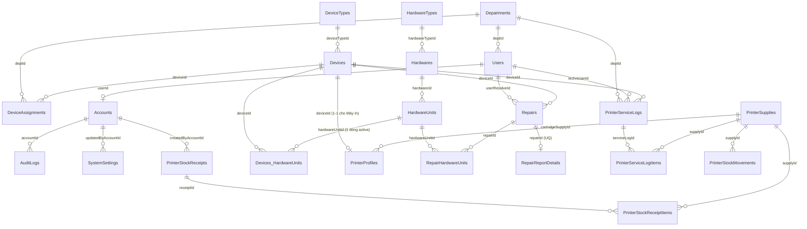

# 3a. DATA-SCHEMA.md — Thiết kế Cơ sở dữ liệu & Chuẩn hóa Stored Procedure

> **Dự án:** Hệ thống Quản lý Thiết bị CNTT (`QuanLyThietBiCNTT`) — Nền tảng CSDL dùng chung đa-WebApp BVĐKKV Long Khánh  
> **Hệ quản trị CSDL:** Microsoft SQL Server 2019 (compatibility level `140` — đã xác minh)  
> **Phiên bản:** 3.0 (Giữ 100% 24 bảng & SP đã xác minh v2.6; bổ sung phân nhóm **Platform Core vs Domain Tables**, cột `appCode` trên `AuditLogs` & `SystemSettings` và hướng dẫn mở rộng schema cho các WebApp bệnh viện sau này theo mô hình Expand-Contract)  
> **Cập nhật lần cuối:** 2026-11-20  
> **Xem thay đổi chi tiết tại:** `CHANGELOG.md` mục `[3.0.0-plan]`

---

## 0. Quy ước chung & Phân vùng Đa-WebApp của CSDL

### 0.1 Quy ước Kỹ thuật Cốt lõi
1. **Bảng cũ đồng bộ từ HIS/HR giữ nguyên tên cột:** `Users.Id`, `Users.IsInactive`. Bảng mới và cột mới dùng `camelCase`.
2. **Kiểu thời gian:** giữ `DATETIME`. Lọc theo khoảng ngày luôn viết `col >= @pStart AND col < DATEADD(DAY, 1, @pEnd)`.
3. **Xóa mềm thay cho xóa cứng** với dữ liệu đối soát (phiếu nhập mực, nhật ký bơm mực): `isCanceled`, `canceledAt`, `canceledByAccountId`, `cancelReason`.
4. **Chống ghi đè đồng thời:** `Devices`, `Repairs`, `DeviceAssignments` có `rowVersion ROWVERSION`; lệch thì `THROW 50010` → HTTP `409 CONCURRENT_MODIFICATION`.
5. **Không hard-code ID danh mục hay Phòng CNTT:** dùng cờ `DeviceTypes.isPrinter` cho Máy In và `SystemSettings.it_department_code` (`'PCNTT'`) cho Phòng CNTT thay vì hardcode `deviceTypeId = 1` hay `deptId = 295`.
6. **Mọi SP** tạo bằng `CREATE OR ALTER` kèm `SET ANSI_NULLS ON; SET QUOTED_IDENTIFIER ON;` và đầu thân SP có `SET NOCOUNT ON; SET XACT_ABORT ON;`.
7. **Tham số danh sách** dùng **Table-Valued Parameter (TVP)** (`tt_IdList`, `tt_HardwareItem`, `tt_SupplyQty`), không dùng CSV/JSON.
8. **Tương thích ngược bắt buộc ở Phase 1:** giữ tên SP hiện hữu, tham số mới thêm cuối có mặc định `NULL`, cột mới thêm cuối, `@pRowVersion = NULL` bỏ qua kiểm tra khi app EJS cũ (`pre-v3.0`) gọi.
9. **Không dùng `ON DELETE CASCADE`:** SP xóa phải xóa bản ghi con tường minh trong cùng transaction.

### 0.2 Phân loại Bảng Nền tảng (`Core`) vs Nghiệp vụ (`ITAM`) & Hướng mở rộng Đa-WebApp
Để `server/` dễ dàng mở rộng cho nhiều WebApp bệnh viện sau này mà không làm rối CSDL:
- **Nhóm 1 — Bảng Lõi Nền tảng Dùng chung (`Core Platform` — 7 bảng):** `Departments`, `Users`, `Sessions`, `Accounts`, `AuditLogs` *(thêm `appCode`)*, `SystemSettings` *(thêm `appCode`)*, `SchemaVersions`. Toàn bộ các WebApp nội bộ bệnh viện cùng sử dụng thống nhất danh mục Khoa/Phòng, Nhân sự, SSO Tài khoản, Cấu hình và Nhật ký từ nhóm này.
- **Nhóm 2 — Bảng Nghiệp vụ `ITAM` (17 bảng hiện hữu & mới ở `dbo`):** `DeviceTypes`, `HardwareTypes`, `Hardwares`, `Devices`, `HardwareUnits`, `Devices_HardwareUnits`, `DeviceAssignments`, `Repairs`, `RepairHardwareUnits`, `RepairReportDetails` và 7 bảng `Printer*`.
- **Nhóm 3 — Quy ước mở rộng cho WebApp tương lai (Expand-Contract):**
  - Khi thêm WebApp mới (vd: `baocao`, `helpdesk`, `vattu`): tạo **SQL Schema riêng** (vd `CREATE SCHEMA helpdesk;`) hoặc kết nối Database độc lập cho nghiệp vụ của ứng dụng đó — **không trộn thêm bảng lạ vào schema `dbo` của `itam`**.
  - Khi cần phân quyền khác nhau giữa nhiều WebApp cho cùng 1 tài khoản (vd: `admin` ở `itam`, `viewer` ở `baocao`), chỉ cần mở rộng thêm bảng `dbo.AccountAppRoles(accountId, appCode, role)` mà không phá vỡ cột `Accounts.role` hiện hành.

---

## 1. Sơ đồ Thực thể Liên kết Tổng thể (ER Diagram)



---

## 2. Chi tiết Cấu trúc các Bảng (24 Bảng Tổng cộng)

### 2.1 Nhóm Bảng Lõi Nền tảng Dùng chung Đa-WebApp (`Core Platform` — 7 bảng)

1. **`dbo.Departments`** (41 dòng hiện hữu): `id`, `code VARCHAR(10) UQ`, `name NVARCHAR(200)`, `note NVARCHAR(200) NULL`, `isInactive BIT DEFAULT(0)`.
2. **`dbo.Users`** (11 dòng — toàn bộ thuộc Phòng CNTT `id = 295`, mã `PCNTT`): giữ nguyên cấu trúc (`Id`, `IsInactive`, `deptId`...).
3. **`dbo.Sessions`** (hiện 4.277 dòng hết hạn — dọn sạch ở migration `V001`): `sid VARCHAR(255) PK`, `sess NVARCHAR(MAX)`, `expire DATETIME`.
4. **`dbo.Accounts` (MỚI — `V002`):** `id`, `username UQ`, `passwordHash`, `fullName`, `role CHECK ('admin','technician','viewer')`, `userId NULL FK -> Users(Id)` (Filtered UQ `WHERE userId IS NOT NULL`), `isLocked`, `failedLoginAttempts`, `lockedUntil`, `mustChangePassword BIT DEFAULT(1)`, `passwordChangedAt`, `lastLoginAt`, `createdAt`, `updatedAt`.
5. **`dbo.AuditLogs` (MỚI — `V002`):** `id BIGINT IDENTITY PK`, **`appCode VARCHAR(30) NOT NULL DEFAULT ('itam')`** *(phân biệt nhật ký giữa các WebApp trên cùng API Server)*, `accountId`, `username`, `action`, `entityType`, `entityId`, `summary`, `payloadJson` *(cấm lưu mật khẩu/hash/token)*, `ipAddress`, `createdAt`.
6. **`dbo.SchemaVersions` (MỚI — `V001`):** `id`, `scriptName VARCHAR(200) UQ`, `checksum CHAR(64)`, `appliedAt`, `appliedBy`.
7. **`dbo.SystemSettings` (MỚI — `V002` — Cấu hình Hệ thống tập trung cho Admin):**
   ```sql
   CREATE TABLE dbo.SystemSettings (
       settingKey VARCHAR(100) NOT NULL PRIMARY KEY,
       settingValue NVARCHAR(500) NULL,
       appCode VARCHAR(30) NOT NULL DEFAULT ('global'), -- 'global', 'itam', <future-app>
       groupName VARCHAR(50) NOT NULL,                  -- 'organization', 'repair_print', 'printer_ink', 'warranty'
       label NVARCHAR(200) NOT NULL,
       description NVARCHAR(300) NULL,
       valueType VARCHAR(20) NOT NULL DEFAULT ('string')
           CONSTRAINT CK_SystemSettings_Type CHECK (valueType IN ('string', 'int', 'bool')),
       updatedByAccountId INT NULL CONSTRAINT FK_SystemSettings_Accounts FOREIGN KEY REFERENCES dbo.Accounts(id),
       updatedAt DATETIME NULL
   );
   ```
   **Các khóa khởi tạo mặc định (seed idempotent ở `V002`):**
   | `settingKey` | `appCode` | `groupName` | `valueType` | Mặc định | Ý nghĩa |
   |---|---|---|---|---|---|
   | `it_department_code` | `global` | `organization` | `string` | `'PCNTT'` | Mã phòng CNTT (thay hardcode `deptId = 295`) |
   | `default_director_name` | `global` | `repair_print` | `string` | `''` | Tên Giám đốc mặc định trên biểu mẫu in |
   | `default_finance_head_name` | `global` | `repair_print` | `string` | `''` | Tên TP.TC-KT mặc định trên biểu mẫu in |
   | `default_admin_head_name` | `global` | `repair_print` | `string` | `''` | Tên TP.HCQT-TCCB mặc định trên biểu mẫu in |
   | `default_it_rep_name` | `itam` | `repair_print` | `string` | `''` | Tên Đại diện Phòng CNTT mặc định trên biểu mẫu in |
   | `warranty_expiring_days` | `itam` | `warranty` | `int` | `'30'` | Ngưỡng số ngày cảnh báo sắp hết bảo hành |
   | `printer_drum_warn_refills` | `itam` | `printer_ink` | `int` | `'3'` | Ngưỡng cảnh báo số lần bơm mực chưa thay Drum |
   | `printer_cartridge_warn_refills` | `itam` | `printer_ink` | `int` | `'5'` | Ngưỡng cảnh báo số lần bơm mực chưa thay Hộp mực |

---

### 2.2 Nhóm Bảng Danh mục & Tài sản ITAM (6 bảng hiện hữu — nâng cấp)

8. **`dbo.DeviceTypes`** (6 dòng): `id`, `code VARCHAR(10) UQ`, `name NVARCHAR(200)`, `note NVARCHAR(200) NULL`, `isInactive BIT DEFAULT(0)`, **`isPrinter BIT NOT NULL DEFAULT(0)` (`V003` đặt `1` cho `code = 'IN'`)**.
9. **`dbo.HardwareTypes`** (8 dòng): `id`, `code VARCHAR(10) UQ`, `name NVARCHAR(200)`, `note NVARCHAR(200) NULL`, `isInactive BIT DEFAULT(0)`.
10. **`dbo.Hardwares`** (121 dòng): `id`, `code VARCHAR(10) UQ`, `name NVARCHAR(200)`, `hardwareTypeId INT FK`, `note NVARCHAR(200) NULL`, `isInactive BIT DEFAULT(0)`.
11. **`dbo.Devices`** (410 dòng hiện hữu): `id INT IDENTITY PK`, `code VARCHAR(50) UQ`, `name NVARCHAR(200)`, `deviceTypeId INT FK`, `purchaseDate DATETIME`, **`warrantyDate DATETIME NULL` (`V003`)**, `note NVARCHAR(200) NULL`, `isInactive BIT DEFAULT(0)`, **`rowVersion ROWVERSION` (`V003`)**.
12. **`dbo.HardwareUnits`** (2.154 dòng hiện hữu):
    > [!IMPORTANT]
    > **Xử lý dữ liệu hiện có trong Migration `V003` (đã xác minh qua Preflight):**
    > - Làm sạch **`2.153` dòng có `warrantyDate = '1900-01-01'` thành `NULL`**.
    > - DROP Unique Constraint trên `serialNumber` (tra động theo catalog), đổi `serialNumber` sang `VARCHAR(100) NULL`, tạo Filtered Unique Index `UX_HardwareUnits_SerialNumber_NotNull`.
    > - Nới `code` từ `VARCHAR(30)` lên `VARCHAR(60)` (DROP & tái tạo Unique Constraint trong cùng transaction).
    > - Quy tắc tự sinh `code` khi trống: `<DeviceCode>-<HardwareCode>-<STT>` (tính `STT` có `WITH (UPDLOCK, HOLDLOCK)`); nếu > 60 ký tự hoặc không có thiết bị → `LK-<id>`.
13. **`dbo.Devices_HardwareUnits`** (2.123 dòng hiện hữu, 100% active): thêm `attachedDate DATETIME NULL`, `detachedDate DATETIME NULL`; DROP `UQ_Devices_Hardware_Unit` (tra động) → tạo `UX_Devices_HardwareUnits_ActiveUnit (hardwareUnitId) WHERE isInactive = 0`. Cập nhật dùng **thuật toán diff** (giữ nguyên dòng không đổi để bảo toàn `attachedDate`, soft-detach dòng bỏ ra, insert dòng thêm mới).

---

### 2.3 Nhóm Bảng Nghiệp vụ Vòng đời ITAM (4 bảng: 3 hiện hữu + 1 mới)

14. **`dbo.DeviceAssignments`** (415 dòng: 410 active, 5 revoked): giữ nguyên cột hiện hữu + thêm **`rowVersion ROWVERSION`**, tạo `UX_DeviceAssignments_ActiveDevice (deviceId) WHERE isInactive = 0 AND endDate IS NULL`.
15. **`dbo.Repairs`** (0 dòng hiện hữu): giữ nguyên cột hiện hữu (`hardwareUnitId` giữ trạng thái DEPRECATED để tương thích) + thêm **`rowVersion ROWVERSION`**, `CK_Repairs_Status ('opened','in-progress','completed','canceled')`, `FK_Repairs_Users`.
16. **`dbo.RepairHardwareUnits` (MỚI — `V004`):** `id INT IDENTITY PK`, `repairId INT FK -> Repairs(id)`, `hardwareUnitId INT FK -> HardwareUnits(id)`, `UQ (repairId, hardwareUnitId)`. *(Không `ON DELETE CASCADE`.)*
17. **`dbo.RepairReportDetails`** (0 dòng hiện hữu): giữ nguyên 33 cột thật (`AS-IS-BASELINE.md` 2.1). Báo cáo dùng `COALESCE(actualRepairHours, expectedRepairHours)` và `estimatedCost`.

---

### 2.4 Nhóm Bảng Máy in, Phiếu nhập Mực & Nhật ký Bơm mực (7 bảng — DDL `V006`, SP & UI Phase 7)
18. **`dbo.PrinterSupplies`**: `id`, `code VARCHAR(30) UQ`, `name`, `supplyType CHECK`, `unit`, `compatibleModels`, `stockQuantity INT DEFAULT(0)` *(cache sổ cái, cho phép âm)*, `minStockThreshold`, `note`, `isInactive`, `createdAt`.
19. **`dbo.PrinterStockReceipts`**: `id`, `receiptCode VARCHAR(50)` *(Filtered UQ `WHERE isCanceled = 0`)*, `receiptDate`, `supplierOrSource`, `note`, `createdByAccountId`, `createdAt`, `isCanceled`, `canceledAt`, `canceledByAccountId`, `cancelReason`.
20. **`dbo.PrinterStockReceiptItems`**: `id`, `receiptId FK`, `supplyId FK`, `quantity CHECK (> 0)`, `note`. *(Không CASCADE.)*
21. **`dbo.PrinterStockMovements`** *(Sổ cái tồn kho)*: `id BIGINT IDENTITY`, `supplyId FK`, `movementType CHECK ('receipt','service_out','cancel_receipt','cancel_service','adjust')`, `quantityDelta INT`, `refType`, `refId`, `note`, `createdByAccountId`, `createdAt`.
22. **`dbo.PrinterProfiles`**: `deviceId INT PK FK -> Devices(id)` *(Không CASCADE)*, `cartridgeSupplyId FK`, `ipAddress`, `connectionType`, `refillCountSinceNewCartridge`, `refillCountSinceNewDrum`, `lastRefillDate`, `lastDrumReplaceDate`, `lastCartridgeReplaceDate`, `note`, `updatedAt`.
23. **`dbo.PrinterServiceLogs`**: `id`, `deviceId FK`, `deptId FK`, `serviceDate`, `actionType CHECK ('refill','replace_cartridge','replace_drum','replace_part','maintenance')`, `pageCounter INT NULL`, `senderName`, `technicianId FK -> Users(Id)`, `note`, `createdByAccountId`, `createdAt`, `isCanceled`, `canceledAt`, `canceledByAccountId`, `cancelReason`.
24. **`dbo.PrinterServiceLogItems`**: `id`, `serviceLogId FK`, `supplyId FK`, `quantity CHECK (> 0)`.

---

### 2.5 Table Types (`V001`) & View Trạng thái (`vw_DeviceCurrentStatus`)
- **Table Types:** `dbo.tt_IdList (id INT)`, `dbo.tt_HardwareItem (hardwareId INT, qty INT)`, `dbo.tt_SupplyQty (supplyId INT, quantity INT, note NVARCHAR(200) NULL)`.
- **View `dbo.vw_DeviceCurrentStatus`:** suy ra `usageStatus` (`inactive` > `under_repair` > `in_use` > `in_stock`), `currentDeptId`, `currentDeptName`, `isUnderRepair`, kèm `warrantyStatus` (`'none'`, `'valid'`, `'expiring'`, `'expired'` dựa trên `Devices.warrantyDate` và `SystemSettings.warranty_expiring_days`).

---

## 3. Chiến lược Đánh chỉ mục (Indexes)
- **Filtered Unique Indexes:** `UX_HardwareUnits_SerialNumber_NotNull`, `UX_DeviceAssignments_ActiveDevice`, `UX_Devices_HardwareUnits_ActiveUnit`, `UX_Accounts_UserId`, `UX_PrinterStockReceipts_Code_Active`.
- **Non-Clustered Indexes:** đầy đủ trên các cột FK, trạng thái và ngày (`Devices`, `Hardwares`, `HardwareUnits`, `Devices_HardwareUnits`, `DeviceAssignments`, `Repairs`, `RepairHardwareUnits`, `Sessions`, `AuditLogs(appCode, createdAt DESC)`, `PrinterServiceLogs`, `PrinterStockMovements`).

---

## 4. Danh mục Stored Procedures (Trọng tâm v3.0)

> Giữ nguyên toàn bộ nguyên tắc tương thích ngược Phase 1 (giữ tên SP hiện hữu, tham số mới thêm cuối mặc định `NULL`, cột mới thêm cuối, `@pRowVersion = NULL` bỏ qua kiểm tra khi app EJS cũ `pre-v3.0` gọi).

| Nhóm | Tên SP | Đặc tả chi tiết |
|---|---|---|
| **Core Platform** | `sp_Auth_*`, `sp_Accounts_*`, `sp_SystemSettings_GetAll/Upsert`, `sp_AuditLogs_Create/GetPaged/Purge`, `sp_Departments_*`, `sp_Users_GetDropdown` | `sp_AuditLogs_Create/GetPaged` hỗ trợ `@pAppCode` (mặc định `'itam'`); `sp_SystemSettings_GetAll` hỗ trợ lọc `@pAppCode NULL` (trả tất cả hoặc theo app). |
| **Thiết bị Quick Config** | `sp_Devices_GetPaged`, `sp_Devices_GetProfile360`, `sp_Devices_SaveWithQuickConfig`, `sp_Devices_Delete` | `SaveWithQuickConfig` nhận `@pWarrantyDate`, TVP `tt_HardwareItem`, chỉ bổ sung không tự gỡ, sinh mã có `UPDLOCK/HOLDLOCK`, kiểm `rowVersion`; `Delete` sửa đúng tên bảng `Devices_HardwareUnits`. |
| **Linh kiện Diff** | `sp_HardwareUnits_*`, `sp_DeviceHardwareUnits_UpdateAssigned`, `_Detach` | Thuật toán diff bảo toàn `attachedDate` dòng không đổi; soft-detach chặn gỡ khi linh kiện đang nằm trong phiếu sửa mở (`50009`). |
| **Bàn giao / Luân chuyển** | `sp_DeviceAssignments_Transfer`, `sp_DeviceAssignments_GetPrintDataById` | `Transfer`: 1 Transaction kiểm `rowVersion`, đóng cũ (`endDate = @pTransferDate, isInactive = 1`), mở mới sang `@pNewDeptId`; `GetPrintDataById`: nối cấu hình linh kiện bằng `STRING_AGG` + người ký mặc định từ `SystemSettings`. |
| **Sửa chữa & In PDF** | `sp_Repairs_Create/Update/Delete`, `sp_Repairs_GetPrintDataById`, `sp_RepairReportDetails_GetSurveyUsers` | Hỗ trợ TVP nhiều linh kiện (`RepairHardwareUnits`); `GetPrintDataById` lấy Khoa/Phòng theo `brokenDate` qua `OUTER APPLY` & gộp linh kiện bằng `STRING_AGG`; `GetSurveyUsers` tra phòng theo `SystemSettings.it_department_code`. |
| **Dashboard & Máy in** | `sp_Dashboard_GetSummary`, `sp_Reports_*`, `sp_Printers_*`, `sp_PrinterSupplies_*`, `sp_PrinterStockReceipts_*`, `sp_PrinterServiceLogs_*` | Đọc ngưỡng cảnh báo từ `SystemSettings`; sổ cái `PrinterStockMovements` cho phép tồn âm & hủy mềm; bộ đếm bơm mực tính lại từ nhật ký. |
