# IMPLEMENTATION-PLAN.md — Kế hoạch Triển khai Nền tảng v3.0 (API Server + React SPA) theo Giai đoạn & Cổng Nghiệm thu

> **Dự án:** Hệ thống Quản lý Thiết bị CNTT (`QuanLyThietBiCNTT`) — Khung Nền tảng WebApp BVĐKKV Long Khánh  
> **Phiên bản:** 5.1 (Bổ sung **Phụ lục A**: Bảng chọn Model Gemini 4 không dùng Carbon, lệnh `/` và mẫu câu mở đoạn chat riêng cho 11 chặng `Phase 0 → 8`, 4 loại nhiệm vụ ngoài kế hoạch & chế độ `Orchestrator` `/teamwork`)  
> **Cập nhật lần cuối:** 2026-11-20  
> **Xem thay đổi chi tiết tại:** `CHANGELOG.md` mục `[3.0.1-plan]`

---

## 0. Quy tắc Thực thi & Chuẩn Nghiệm thu Bắt buộc (ĐỌC KỸ TRƯỚC MỌI TASK)

1. **Bắt buộc tuân thủ `AGENTS.md` + `PROJECT-RULES.md` v3.0 trước khi đụng bất kỳ dòng code/SQL/UI nào:**
   - **Mục 0 (Zero-Assumption & Kiểm tra 4 Lớp):** cấm tuyệt đối suy đoán; đọc đủ 4 lớp (*Tài liệu → Code dọc `server/` & `client/` + Blast Radius → DB/SP thật → Design System*) và dừng hỏi ngay khi gặp Mục 0.3.
   - **Mục 6, 11, 12, 13, 14:** tuân thủ 10 điều cấm AI, chạy đúng 6 bước `SOP-0`, giữ sạch ranh giới `core/` vs `itam/` và `design-system/` vs `features/`, chạy `self-audit.mjs`, và hoàn tất 12/12 mục Mục 13.
2. **Chưa đụng DB Production hay source code khi chủ dự án chưa yêu cầu.** Mỗi lượt chỉ làm đúng Task/Phase được giao; mỗi Task = 1 commit (`T<ID>: <mô tả>`).
3. **Không bao giờ chạy DDL/DML trên Production** — mọi migration & test chỉ chạy trên `QuanLyThietBiCNTT_DEV` qua `scripts/migrate.js`.
4. **Báo cáo Nghiệm thu Bắt buộc ở CẢ 2 CẤP ĐỘ (`PROJECT-RULES.md` Mục 10):**
   - **Cấp Task (`T<P>.<N>`):** (1) File diff, (2) Script + output nguyên văn (gồm `self-audit.mjs`, `typecheck`/`build` nếu chạm `client/`), (3) Screenshot (≥ 1366px đúng màu BVĐKKV Long Khánh, 3 vai trò, Console `0` lỗi, Network `0` CDN ngoài), (4) Bảng `PASS/FAIL`.
   - **Cấp Phase Gate (`🔒 GATE`):** tạo `docs/acceptance/PHASE-<N>-REPORT.md` + ảnh `docs/acceptance/images/phase-<N>/`, bảng `rowCounts` (NFR-06), **DỪNG chờ duyệt mới mở Phase kế tiếp**.

---

## Sơ đồ Lộ trình 11 Chặng & Các Cổng Nghiệm thu (`🔒 GATE`)

```mermaid
flowchart LR
    P0["Phase 0<br/>DEV DB, Baseline,<br/>Tag pre-v3.0 & Runner<br/>🔒 GATE 0"] --> P1A["Phase 1A<br/>DB Migrations<br/>V001-V007<br/>🔒 GATE 1A"]
    P1A --> P1B["Phase 1B<br/>Stored Procedures<br/>& Test SQL<br/>🔒 GATE 1B"]
    P1B --> P2A["Phase 2A<br/>server/: Express 5<br/>Modular API Core<br/>🔒 GATE 2A"]
    P2A --> P2B["Phase 2B<br/>client/: React+Vite<br/>& BVĐKKV UI Kit<br/>🔒 GATE 2B"]
    P2B --> P3["Phase 3<br/>SSO Auth, Admin,<br/>Dashboard 4 Tabs<br/>🔒 GATE 3"]
    P3 --> P4["Phase 4<br/>Master Data &<br/>Cụm Linh kiện<br/>🔒 GATE 4"]
    P4 --> P5["Phase 5<br/>Thiết bị: Quick Config,<br/>360, Clone, CSV, QR<br/>🔒 GATE 5"]
    P5 --> P6["Phase 6<br/>Bàn giao/Chuyển PDF<br/>& Sửa chữa Queue<br/>🔒 GATE 6"]
    P6 --> P7["Phase 7<br/>Máy in, Phiếu nhập<br/>Mực & Bơm mực<br/>🔒 GATE 7"]
    P7 --> P8["Phase 8<br/>Load Test 200 CCU,<br/>Security & Cutover<br/>🔒 GATE 8"]
```



---

## PHASE 0 — Môi trường DEV, Chốt Baseline & Migration Runner (KHÔNG đụng Production)

> **Lưu ý:** Khảo sát hiện trạng (`AS-IS-BASELINE.md` v1.0) và 2 script chỉ đọc `scripts/baseline/export-schema.sql`, `preflight-checks.sql` đã sẵn sàng.

### T0.1 — Tạo DB DEV, Login phân quyền & Tag Git `pre-v3.0` *(chủ dự án thực hiện, AI hướng dẫn)*
- **Làm:** (1) Backup Production `QuanLyThietBiCNTT` và kiểm tra file backup; (2) Restore ra `QuanLyThietBiCNTT_DEV`; (3) Tạo 2 SQL login trên DEV: `qltb_migrator` (`db_owner`) và `qltb_app` (chỉ `EXECUTE` trên `dbo` + CRUD riêng trên `dbo.Sessions`); (4) Tạo Git tag `pre-v3.0` (bảo toàn nguyên bản EJS cũ để rollback) và nhánh `feature/v3.0`.
- **Nghiệm thu:** Output so sánh `rowCounts` 12 bảng Prod vs DEV (khớp 100%); output kết nối 2 login; output `git tag` & `git branch`.

### T0.2 — Xuất nguyên trạng DB DEV vào `db/sql/baseline/`
- **Tạo/Sửa:** `db/sql/baseline/*` (chỉ đọc).
- **Nghiệm thu:** Đầy đủ bản xuất cấu trúc bảng & 40+ SP hiện hữu khớp 100% `docs/AS-IS-BASELINE.md`.

### T0.3 — Xây dựng Runner Migration `scripts/migrate.js`, `.env.example` & Root `package.json` Scripts
- **Đọc:** `ARCHITECTURE.md` 4–5; `DATA-SCHEMA.md` 2.1 (#6). **Tạo/Sửa:** `scripts/migrate.js`, `.env.example`, cập nhật script quản lý.
- **Làm:** Chạy `db/sql/migrations/V*.sql` theo thứ tự với `SchemaVersions` + SHA-256 (từ chối sửa file đã chạy) trong transaction; chạy `db/sql/procedures/*.sql` tách theo `GO`. Guard cứng từ chối nếu `DB_DATABASE` không kết thúc `_DEV` trừ khi có `--prod --backup-confirmed`.
- **Nghiệm thu:** Output test 3 tình huống (chạy `_DEV` thành công, từ chối non-`_DEV`, báo lỗi sai checksum).

### 🔒 GATE 0 (`docs/acceptance/PHASE-0-REPORT.md`)
- Xác nhận Production chưa bị đụng chạm, DB DEV + `pre-v3.0` + runner sẵn sàng. Chờ duyệt mới mở Phase 1A.

---

## PHASE 1A — Database Migrations: Bảng Core & ITAM, Làm sạch Dữ liệu & Indexes (Trên DEV)

### T1.1 — `V001`: `SchemaVersions`, Table Types & Dọn 4.277 `Sessions` hết hạn
- **Tạo/Sửa:** `db/sql/migrations/V001__schema_versions_types_sessions.sql`.
- **Nghiệm thu:** `migrate.js` chạy 2 lần (lần 2 skip 100%); đủ 3 TVP (`tt_IdList`, `tt_HardwareItem`, `tt_SupplyQty`); `Sessions` hết hạn = `0`.

### T1.2 — `V002`: `Accounts`, `AuditLogs` (có `appCode`), `SystemSettings` (có `appCode`) + `passwordHash.js` + `seed-admin.js`
- **Tạo/Sửa:** `db/sql/migrations/V002__accounts_audit_settings.sql`, `server/src/shared/passwordHash.js`, `scripts/seed-admin.js`, `server/tests/shared/passwordHash.test.js`.
- **Làm:** Tạo 3 bảng Core Platform (thêm `appCode` trên `AuditLogs` mặc định `'itam'` và `SystemSettings` mặc định `'global'`), seed 8 khóa cấu hình mặc định; cài `crypto.scrypt` + `timingSafeEqual` và `seed-admin.js` (`mustChangePassword = 1`, in mật khẩu tạm 1 lần).
- **Nghiệm thu:** `node --test` PASS; chạy `seed-admin.js` 2 lần (lần 2 báo đã tồn tại); `SELECT settingKey, appCode, settingValue FROM dbo.SystemSettings` đủ 8 dòng.

### T1.3 — `V003`: Nâng cấp `DeviceTypes`, `Devices` & Làm sạch `HardwareUnits`
- **Tạo/Sửa:** `db/sql/migrations/V003__devicetypes_devices_hardwareunits.sql`.
- **Làm:** Thêm `DeviceTypes.isPrinter` (`1` cho `'IN'`); thêm `Devices.warrantyDate` & `rowVersion`; trên `HardwareUnits`: làm sạch **2.153 dòng `warrantyDate = '1900-01-01'` → `NULL`**, nới `code` lên `VARCHAR(60)`, DROP UQ cũ trên `serialNumber` theo catalog → đổi sang `VARCHAR(100) NULL` → tạo `UX_HardwareUnits_SerialNumber_NotNull`.
- **Nghiệm thu:** `Devices = 410`, `HardwareUnits = 2.154`, `warrantyDate = '1900-01-01'` giảm từ `2.153 → 0`; test `ROLLBACK` 2 `NULL` serial thành công, 2 serial trùng bị chặn.

### T1.4 — `V004`: Lịch sử `Devices_HardwareUnits` & Bảng `RepairHardwareUnits`
- **Tạo/Sửa:** `db/sql/migrations/V004__hardware_history_and_repair_units.sql`.
- **Nghiệm thu:** `Devices_HardwareUnits = 2.123`; test `ROLLBACK` gỡ máy A sang máy B giữ lịch sử, gắn đồng thời 2 máy bị chặn.

### T1.5 — `V005`: Ràng buộc `DeviceAssignments` & `Repairs`
- **Tạo/Sửa:** `db/sql/migrations/V005__assignments_repairs_constraints.sql`.
- **Nghiệm thu:** Test `ROLLBACK` chặn gán active trùng và chặn `status` sai; `DeviceAssignments = 415`.

### T1.6 — `V006` & `V007`: 7 Bảng Máy in/Mực + Toàn bộ Non-Clustered Indexes
- **Tạo/Sửa:** `db/sql/migrations/V006__printer_ink_tables.sql`, `db/sql/migrations/V007__indexes.sql`.
- **Nghiệm thu:** `sys.tables` đủ 24 bảng; `sys.indexes` đủ index mới (gồm `AuditLogs(appCode, createdAt DESC)`); chạy lại `migrate.js` skip sạch.

### 🔒 GATE 1A (`docs/acceptance/PHASE-1A-REPORT.md`)
- Đối chiếu `rowCounts` 12 bảng gốc (0 mất dữ liệu); chứng minh code EJS cũ `pre-v3.0` vẫn chạy bình thường trên DB DEV sau `V001–V007`.

---

## PHASE 1B — Chuẩn hóa Toàn bộ Stored Procedures & Kiểm thử SQL (Trên DEV)

### T1.8 — SP Danh mục nền (`02_sp_master_data.sql`) + Test SQL
- `Departments` (thêm `@pCodeSearch`), `DeviceTypes` (`isPrinter`), `HardwareTypes`, `Hardwares`, `Users` dropdown (lọc theo `SystemSettings.it_department_code`); test `db/tests/02_master_data.test.sql` (`ROLLBACK`).

### T1.9 — View `vw_DeviceCurrentStatus` + SP Thiết bị Đọc/Xóa/360° (`03_sp_devices_units.sql` phần 1)
- View 4 trạng thái + `warrantyStatus`; `sp_Devices_GetPaged`, `sp_Devices_GetProfile360` (5 recordsets), sửa `sp_Devices_Delete`; test `db/tests/03_devices_read.test.sql`.

### T1.10 — SP `sp_Devices_SaveWithQuickConfig` (`03_sp_devices_units.sql` phần 2)
- Hỗ trợ `@pWarrantyDate`, TVP `tt_HardwareItem`, chỉ bổ sung không tự gỡ, sinh mã `UPDLOCK/HOLDLOCK`, kiểm `rowVersion`; test đủ 7 kịch bản `db/tests/03_devices_quick_config.test.sql`.

### T1.11 — SP Linh kiện & Gán/Gỡ Lịch sử Diff (`03_sp_devices_units.sql` phần 3)
- `HardwareUnits` (`VARCHAR(60)`, tự sinh code, `serialNumber NULL`, `warrantyDate`); `UpdateAssigned` thuật toán diff bảo toàn `attachedDate`; `_Detach` soft-detach chặn khi đang sửa mở; test `db/tests/03_hardware_units.test.sql`.

### T1.12 — SP Bàn giao, Luân chuyển 1 Bước & Dữ liệu In Biên bản (`04_sp_assignments.sql`)
- `Create`/`Update`/`Revoke`/`Transfer` (1 Transaction đóng cũ + mở mới) + `GetPrintDataById` (`STRING_AGG` + người ký mặc định từ `SystemSettings`); test `db/tests/04_assignments.test.sql`.

### T1.13 — SP Sửa chữa Nhiều Linh kiện & Dữ liệu In PDF (`05_sp_repairs_print.sql`)
- `Create`/`Update` (TVP `tt_IdList` → `RepairHardwareUnits`, `rowVersion`), `Delete` (xóa tường minh, chỉ `opened`), `GetPrintDataById` (`OUTER APPLY` theo `brokenDate` + `STRING_AGG`), `GetSurveyUsers` (dùng `it_department_code`); test `db/tests/05_repairs.test.sql`.

### T1.14 — SP Core Auth, Accounts, SystemSettings, AuditLogs, Dashboard & Báo cáo (`06_sp_auth_audit_dash.sql`)
- `sp_Auth_*`, `sp_Accounts_*`, `sp_SystemSettings_GetAll/Upsert` (hỗ trợ `@pAppCode`), `sp_AuditLogs_Create/GetPaged/Purge` (hỗ trợ `@pAppCode`), `sp_Dashboard_GetSummary`, `sp_Reports_DeviceUsage`, `sp_Reports_RepairSummary`; test `db/tests/06_auth_reports.test.sql`.

### 🔒 GATE 1B (`docs/acceptance/PHASE-1B-REPORT.md`)
- Chạy **code EJS cũ `pre-v3.0`** trên DB DEV sau toàn bộ Phase 1 chứng minh NFR-08 (không lỗi); dán output 100% `db/tests/*.test.sql` PASS; kiểm tra `0` SP có `QUOTED_IDENTIFIER OFF`. Chờ duyệt mở Phase 2A.

---

## PHASE 2A — Nền tảng Backend: `server/` Express 5 Modular API Server & IIS

### T2.1 — Khởi tạo `server/`, Config Môi trường (`env.js`), SQL Pool (`db.js`) & Quyền `qltb_app`
- **Tạo:** `server/package.json`, `server/src/config/{env.js,db.js,cors.js}`.
- **Nghiệm thu:** Test fail-fast khi thiếu `SESSION_SECRET`; test kết nối `qltb_app` gọi SP thành công nhưng `SELECT * FROM Devices` bị SQL từ chối (`permission denied`).

### T2.2 — Tối ưu `MSSQLStore` (Touch Throttling 5 phút, Bỏ DDL) & Cookie SSO `bv_lk.sid`
- **Tạo:** `server/src/shared/sessionStore.js`, `server/src/config/session.js`.
- **Nghiệm thu:** Test 20 request liên tiếp → `UPDATE Sessions` chạy ≤ 1 lần; xóa session trong DB → request tiếp theo bị `401` ngay lập tức.

### T2.3 — Bộ `shared/` Chuẩn (`apiResponse`, `AppError`, `asyncHandler`, `pagination`, `csv`) & Middleware (`validate`, `errorHandler`)
- **Tạo:** `server/src/shared/{apiResponse,AppError,asyncHandler,pagination,csv}.js`, `server/src/middleware/{validate,errorHandler}.js`, `server/tests/shared/{errorHandler,csv}.test.js`.
- **Nghiệm thu:** `node --test` kiểm đủ HTTP `400/401/403/404/409(BUSINESS)/409(CONCURRENT)/429/500` (ẩn stack 500) và CSV BOM UTF-8 + chống formula injection.

### T2.4 — Bảo mật SPA: `authMiddleware` (Auth Adapter), `csrfMiddleware`, `rateLimiter` & `auditLogService`
- **Tạo:** `server/src/middleware/{authMiddleware,csrfMiddleware,rateLimiter}.js`, `server/src/modules/core/audit-logs/auditLog.service.js`, `server/tests/security.test.js`.
- **Nghiệm thu:** Test thiếu CSRF → `403`, `viewer` gọi POST → `403`, chưa login → `401`, audit tự lọc bỏ `password`/`token` và gắn đúng `appCode`.

### T2.5 — Khung `server/src/app.js`, `server.js`, `/api/v1/healthz`, OpenAPI 3.1, `web.config` & `ecosystem.config.cjs`
- **Tạo/Sửa:** `server/src/{app.js,server.js}`, `server/src/modules/core/{index.js,health/*}`, `server/docs/openapi.yaml`, `web.config` (bỏ `iisnode` & `maxConcurrentRequests=1`), `ecosystem.config.cjs` (PM2 fork, 0 mật khẩu).
- **Nghiệm thu:** `GET /api/v1/healthz` → `200 { status: "ok", db: "connected" }`; kiểm `req.ip` sau proxy; `self-audit.mjs` = `0` findings.

### 🔒 GATE 2A (`docs/acceptance/PHASE-2A-REPORT.md`)
- Tổng hợp toàn bộ test bảo mật, pool, session, `/api/v1/healthz`, `openapi.yaml` & `self-audit.mjs`. Chờ duyệt mở Phase 2B.

---

## PHASE 2B — Nền tảng Frontend: `client/` React + Vite + TypeScript & BVĐKKV Long Khánh Design System

### T2.6 — Khởi tạo `client/` (React 19 + Vite + TypeScript + Tailwind CSS + 100% Offline Fonts/Icons/QR)
- **Tạo:** `client/package.json`, `client/vite.config.ts` (`base: VITE_BASE_PATH`, proxy `/api`), `client/tsconfig.json`, `client/index.html` (0 CDN), `client/src/main.tsx` (font WOFF2 `@fontsource`), `client/src/design-system/tokens.css` (bảng màu chuẩn BVĐKKV Long Khánh `#00548F`/`#005A9C`/`#0B8A5C`/`#F4F7FA`).
- **Nghiệm thu:** `npm run typecheck` & `npm run build` PASS (`0` lỗi); `self-audit.mjs` xác nhận `0` link CDN/Google Fonts; Express phục vụ được `client/dist/` dưới sub-path `/QuanLyThietBiCNTT/`.

### T2.7 — Xây dựng `<HospitalShell>` & Bộ Component Dùng Chung Đa-WebApp (`client/src/design-system/`)
- **Đọc:** `UI-DESIGN.md` Mục 1–3.
- **Tạo:** `HospitalShell.tsx` (Sidebar trái xanh `#00548F` + Logo BV ĐKKV Long Khánh + User Card + Accordion Menu + Footer PCNTT; Topbar gạch dọc xanh `#005A9C` + nút Đăng xuất đỏ), `FilterCard.tsx`, `DataTable.tsx` (Header xanh `#005A9C`, sticky column, **empty/loading căn giữa viewport**, pagination), `Modal.tsx`, `ConfirmDialog.tsx`, `StatusBadge.tsx`, `SearchableSelect.tsx`, `Toast.tsx`, `RequireRole.tsx`, `PrintHeader.tsx`.
- **Nghiệm thu:** **Ảnh chụp** giao diện khung chuẩn trên Desktop `≥ 1366px` (đối chiếu trực tiếp phong cách mẫu WebApp Báo cáo BV ĐKKV Long Khánh), ảnh thu gọn sidebar, ảnh bảng nhiều cột có empty state căn giữa, ảnh DevTools Console `0` lỗi & Network `0` CDN ngoài Internet.

### T2.8 — Tầng Giao tiếp API (`apiClient.ts`, `authContext.tsx`, `formatters.ts`, `qrLabel.ts`) & Đo Tải Nền API (`T2.9`)
- **Tạo:** `client/src/shared/{apiClient.ts,authContext.tsx,formatters.ts,qrLabel.ts,types.ts}`, `scripts/loadtest/baseline.js`.
- **Nghiệm thu:** Test tự gắn `X-CSRF-Token`, tự xử lý `401`/`403 PASSWORD_CHANGE_REQUIRED`/`409 CONCURRENT_MODIFICATION`; lưu mốc đo tải nền 50/100/200 kết nối vào `CHANGELOG.md`.

### 🔒 GATE 2B (`docs/acceptance/PHASE-2B-REPORT.md`)
- **Nghiệm thu trực quan Bộ UI/UX BVĐKKV Long Khánh** trước khi code các màn hình nghiệp vụ: ảnh chụp `<HospitalShell>` + toàn bộ component mẫu + DevTools Network `0` CDN + xác nhận `design-system/` độc lập 100% không phụ thuộc `features/`. Chờ duyệt mở Phase 3.

---

## PHASE 3 — SSO Auth, Quản trị Core (`Accounts`, `Settings`, `AuditLogs`) & Dashboard Báo cáo 4 Tabs

### T3.1 — Backend & Giao diện Đăng nhập (`/login`), Đăng xuất & Modal Ép/Tự Đổi Mật khẩu
- **Tạo:** `server/src/modules/core/auth/*`, `client/src/features/auth/{LoginPage.tsx,ChangePasswordModal.tsx}`, `server/tests/core/auth.test.js`.
- **Nghiệm thu:** Test 6 lần sai liên tiếp (thông báo chung + khóa tạm 15p), đổi session ID, ép đổi mật khẩu lần đầu; **ảnh chụp** trang `/login` và Modal ép đổi mật khẩu không có nút đóng.

### T3.2 — Module Quản trị Core: Tài khoản (`/admin/accounts`), Cấu hình (`/admin/settings`) & Nhật ký (`/admin/audit-logs`)
- **Tạo:** `server/src/modules/core/{accounts,settings,audit-logs}/*`, `client/src/features/admin/{AccountsPage,SettingsPage,AuditLogsPage}.tsx`, tests API.
- **Nghiệm thu:** Script test API (tạo tài khoản + mật khẩu tạm hiện 1 lần, lưu `SystemSettings`, lọc `AuditLogs` theo `appCode`, `technician`/`viewer` bị `403`); **ảnh chụp** cả 3 trang ở quyền `admin` và chứng minh mục `⚙️ Quản trị` bị ẩn ở `technician`/`viewer`.

### T3.3 — Backend & Trang chủ Dashboard KPI + Trung tâm Báo cáo Đa chiều (Tab 1–3 + In A4 + CSV)
- **Tạo:** `server/src/modules/itam/dashboard/*`, `client/src/features/dashboard/*` (Tổng quan KPI + 2 màn hình Báo cáo Sử dụng Thiết bị & Sửa chữa theo đúng chuẩn mẫu WebApp Báo cáo bệnh viện).
- **Nghiệm thu:** Output đối chiếu KPI (`totalDevices + inactiveDevices = 410`), tổng ma trận = tổng chi tiết, CSV mở đúng tiếng Việt & chống formula injection; **ảnh chụp** Trang chủ KPI, Báo cáo Sử dụng, Báo cáo Sửa chữa & Xem trước In A4 ngang.

### 🔒 GATE 3 (`docs/acceptance/PHASE-3-REPORT.md`)
- Smoke test Đăng nhập → Đổi MK → Cấu hình Hệ thống → Dashboard & Xuất Báo cáo ở đủ 3 vai trò. Chờ duyệt mở Phase 4.

---

## PHASE 4 — Danh mục Nền (`Departments`, `DeviceTypes`) & Cụm 4 Tab Linh kiện (`/hardware`)

### T4.1 — Khoa/Phòng (`/api/v1/core/departments`) & Loại Thiết bị (`/api/v1/itam/device-types` + `isPrinter`)
- **Tạo:** `server/src/modules/core/departments/*`, `server/src/modules/core/users/*`, `server/src/modules/itam/device-types/*`, `client/src/features/master-data/{DepartmentsPage,DeviceTypesPage}.tsx`, tests API.
- **Nghiệm thu:** Test lọc `code`, bật `isPrinter` chỉ `admin`, kiểm `403` cho `technician`/`viewer`; **ảnh chụp** bảng & Modal ở quyền `admin` và `viewer`.

### T4.2 — Cụm 4 Tab Linh kiện (`/hardware`: Cá thể, Mẫu PC, Loại PC, Gán/Gỡ)
- **Tạo:** `server/src/modules/itam/{hardware-types,hardwares,hardware-units,device-hardware}/*`, `client/src/features/hardware/*`, tests API.
- **Nghiệm thu:** Test sửa Phần cứng có `hardwareTypeId`, tạo 2 `HardwareUnits` không Serial & tự sinh mã, bảo hành sạch (0 dòng `1900-01-01`), lịch sử gắn/gỡ bảo toàn `attachedDate` và chặn gỡ khi đang sửa (`409`); **ảnh chụp** cả 4 Tab & Modal.

### 🔒 GATE 4 (`docs/acceptance/PHASE-4-REPORT.md`)
- Tổng hợp ảnh chụp 6 màn hình danh mục & linh kiện ở 3 vai trò + output API tests & `AuditLogs`. Chờ duyệt mở Phase 5.

---

## PHASE 5 — Màn hình Thiết bị (`/devices`): Quick Config 1 Bước, 360°, Clone, Bulk Import CSV & Tem QR

### T5.1 — Backend Thiết bị (`/api/v1/itam/devices/*`): Quick Config, Bảo hành, `rowVersion`, 360° & Bulk Import CSV
- **Tạo:** `server/src/modules/itam/devices/*`, `server/tests/itam/devices.test.js`.
- **Nghiệm thu:** Test `POST/PUT` Quick Config (+ `warnings` + `409 CONCURRENT_MODIFICATION`), `GET /:id/profile-360` (5 recordsets), `POST /import/preview` (bắt đúng dòng lỗi) & `POST /import/commit` (`Idempotency-Key`).

### T5.2 — Giao diện Thiết bị (`/devices`): Bảng, Modal Quick Config, Clone 1-Click & Hồ sơ 360° (+ Mobile QR)
- **Tạo:** `client/src/features/devices/{DevicesPage,components/DeviceModal,components/Profile360Modal}.tsx`.
- **Nghiệm thu:** **Ảnh chụp** bảng Thiết bị (4 trạng thái + Bảo hành + Cấu hình), Modal Quick Config (2 thanh RAM), Clone 1-Click, cảnh báo 2 tab sửa đồng thời (`409`), Hồ sơ 360° mở qua `/devices?profileId=<id>` trên Desktop & khung nhìn di động (`390×844`).

### T5.3 — Giao diện Nhập Hàng loạt CSV (Dry-run Preview) & In Tem dán QR Offline
- **Tạo:** `client/src/features/devices/components/{BulkImportModal,QrPrintModal}.tsx`.
- **Nghiệm thu:** **Ảnh chụp** Modal Import CSV (dòng hợp lệ xanh / dòng lỗi đỏ) và Xem trước In Tem QR (A4 3×8 & tem nhiệt 50×30mm) với DevTools Network `0` request ra Internet.

### 🔒 GATE 5 (`docs/acceptance/PHASE-5-REPORT.md`)
- Smoke test Tạo máy 1 bước → Clone → Import lô 5 máy in CSV → Mở 360° → Xem trước Tem QR. Chờ duyệt mở Phase 6.

---

## PHASE 6 — Bàn giao / Luân chuyển 1 Bước + Biên bản PDF & Sửa chữa Nhiều Linh kiện + Hàng đợi PDF

### T6.1 — Hàng đợi PDF Dùng Chung (`server/src/shared/docxReportService.js`) & Dọn File Tạm
- **Tạo:** `server/src/shared/{docxReportService.js,cleanupTempReports.js}`, `templates/assignments/{handover-template.docx,revoke-template.docx}`, test song song 10 job PDF.
- **Nghiệm thu:** Test 10 PDF song song qua 2 slot không treo/không rò rỉ tiến trình `soffice.exe`, job vượt ngưỡng queue trả `429`.

### T6.2 — Bàn giao (`/assignments`): `rowVersion`, Luân chuyển 1 Bước & Xuất Biên bản Bàn giao / Thu hồi PDF
- **Tạo:** `server/src/modules/itam/assignments/*`, `client/src/features/assignments/*`, tests API.
- **Nghiệm thu:** Test gán mới, gán trùng (`409`), luân chuyển Khoa A → Khoa B trong 1 transaction, thu hồi, `409 CONCURRENT_MODIFICATION`; **ảnh chụp** Modal Luân chuyển & **ảnh chụp file PDF** Biên bản Bàn giao / Thu hồi.

### T6.3 — Sửa chữa (`/repairs`): Nhiều Linh kiện, Badge Bảo hành, Tự điền `SystemSettings` & 2 Mẫu PDF
- **Tạo:** `server/src/modules/itam/repairs/*`, `client/src/features/repairs/*`, tests API.
- **Nghiệm thu:** Test tạo phiếu 3 linh kiện, tự điền Lãnh đạo ký từ `SystemSettings`, xuất 2 mẫu PDF chuẩn Khoa/Phòng tại ngày hỏng + gộp nhiều linh kiện bằng `STRING_AGG`; **ảnh chụp** Modal tạo phiếu, Modal Biểu mẫu và **ảnh chụp 2 file PDF**.

### 🔒 GATE 6 (`docs/acceptance/PHASE-6-REPORT.md`)
- Smoke test khép kín vòng đời Thiết bị CNTT (Nhập → Bàn giao → Luân chuyển + Biên bản PDF → Sửa chữa nhiều linh kiện + 2 mẫu PDF → Thu hồi). Chờ duyệt mở Phase 7.

---

## PHASE 7 — Module Mở rộng: Máy in, Phiếu nhập Vật tư Mực & Bơm mực (`/printer-ink`)

### T7.1 — Seed Vật tư Mực & Toàn bộ SP Máy in (`V008`, `08_printer_ink.sql`, `08_printer_ink.test.sql`)
- **Nghiệm thu:** Output `db/tests/08_printer_ink.test.sql` PASS (phiếu nhập `receiptCode` duy nhất, sổ cái `PrinterStockMovements`, bơm mực tồn âm, hủy mềm hoàn kho, tính lại bộ đếm theo `SystemSettings`).

### T7.2 — Backend `/api/v1/itam/printer-ink/*` & API Báo cáo Tab 4 Dashboard
- **Tạo:** `server/src/modules/itam/printer-ink/*`, cập nhật `dashboard/*`, tests API.
- **Nghiệm thu:** Test `200/201/400/403/409`, `Idempotency-Key` chống gửi đúp, `technician` không hủy được phiếu nhập (`403`).

### T7.3 — Giao diện `/printer-ink` (4 Tabs) & Kích hoạt Báo cáo Máy in trên Dashboard
- **Tạo:** `client/src/features/printer-ink/*`, cập nhật `client/src/features/dashboard/*`.
- **Nghiệm thu:** **Ảnh chụp** 4 Tabs (`Danh sách Máy in & Bơm mực 1-Click`, `Nhật ký & Hủy mềm`, `Kho Vật tư tô đỏ tồn âm`, `Phiếu nhập kho theo Mã phiếu nhập`) + Báo cáo Máy in & file CSV.

### 🔒 GATE 7 (`docs/acceptance/PHASE-7-REPORT.md`)
- Tổng hợp kết quả test SQL, API, bộ ảnh 4 Tab `/printer-ink` + Dashboard Tab 4. Chờ duyệt mở Phase 8.

---

## PHASE 8 — Kiểm thử Tải 200 CCU, Bảo mật, Diễn tập Cutover & Go-live Production

### T8.1 — Kiểm thử Tải 100 → 200 Kết nối Đồng thời (`scripts/loadtest/`)
- **Nghiệm thu:** p95 `< 500 ms`, `0` lỗi 5xx, CPU Node `< 60%`, `0` truy vấn > 1 giây trên `sys.dm_exec_query_stats`, thời gian tải React SPA LAN `< 300 ms`.

### T8.2 — Rà soát Bảo mật Toàn diện, OpenAPI & `npm audit`
- **Nghiệm thu:** `npm audit` sạch `high/critical` ở cả `server/` và `client/`, kiểm OWASP Top 10 (Cookie `HttpOnly` + CSRF, RBAC 100% route `/api/v1/*`, XSS payload, ẩn lỗi 500, `self-audit.mjs --all` = `0` findings), hoàn thiện `server/docs/openapi.yaml`.

### T8.3 — Soạn & Diễn tập Runbook Cutover từ EJS cũ sang Nền tảng v3.0 (`docs/RUNBOOK-GO-LIVE.md`)
- **Nghiệm thu:** Biên bản diễn tập trọn quy trình trên DEV (`backup → migrate → build client/dist → smoke test → rollback về pre-v3.0 → restore`).

### 🔒 GATE 8 — Duyệt Go-live Production (`docs/acceptance/PHASE-8-REPORT.md`)
- Ký duyệt triển khai Production. Sau ≥ 2 tuần vận hành ổn định: (1) Dọn 21 SP rác/backup (`AS-IS-BASELINE.md` 2.3), (2) Bật **HTTPS CA nội bộ** trên IIS (`COOKIE_SECURE=true`), (3) Sẵn sàng cắm thêm WebApp thứ 2 (vd Báo cáo CĐHA/Lâm sàng/TCKT) vào cùng nền tảng API Server & `design-system/`.

---

## Phụ lục A — Hướng dẫn Chọn Model Gemini 4, Lệnh `/` & Mở Đoạn Chat Theo Từng Giai đoạn / Nhiệm vụ

> **Nguyên tắc chọn Model (chỉ dùng nhóm Gemini 4, không dùng Carbon):**
> - **`Gemini 4 Argon` & `Orchestrator (Argon)`:** mạnh nhất về tư duy kiến trúc, bảo mật & đối chiếu nhiều tầng — ưu tiên cho nền tảng DB/SP khó, Express API Core, BVĐKKV Design System, tính năng phức tạp & Audit cuối.
> - **`Gemini 4 Neon` & `Gemini 4 Hydrogen` (`Medium` / `High` / `XHigh`):** tốc độ nhanh, quota hồi theo ngày — dùng làm lực lượng chủ lực cho triển khai code, CRUD, UI từng màn hình & kiểm thử.
> - Khi mở **đoạn chat mới**, file `AGENTS.md` ở gốc dự án tự động nạp 100% cùng bộ 5 Workspace Skills tại `.agents/skills/`.

### A.1 Bảng Chọn Model Gemini 4 & Lệnh `/` cho 11 Chặng Triển khai (`Phase 0 → Phase 8`)

| Chặng / Phase | Phạm vi chính | Model Gemini 4 khuyến nghị | Lệnh `/` đầu tin nhắn | Dùng kèm Prompt (`PROJECT-RULES.md` Mục 14) & File `@` |
|---|---|---|---|---|
| **Phase 0** (`T0.1–T0.3`) | Tạo DB DEV, Baseline `db/sql/baseline/`, Runner `scripts/migrate.js`, `.env.example` | **Gemini 4 Hydrogen (`Medium`)** *(hoặc `Neon Medium`)* | *(Không cần `/`)* | **Mẫu 1B** (`[Phase 0]`) — *T0.1 chạy backup/restore SQL theo hướng dẫn của AI rồi tiếp T0.2–T0.3* |
| **Phase 1A** (`T1.1–T1.6`) | 7 file Migration `V001–V007` (24 bảng, làm sạch `1900-01-01`, TVP, Indexes) + `seed-admin.js` | **Gemini 4 Neon (`High`)** *(hoặc `Argon Medium`)* | **`/goal`** | **Mẫu 1B** (`[Phase 1A]`) + `@docs/acceptance/PHASE-0-REPORT.md` |
| **Phase 1B** (`T1.8–T1.14`) | Toàn bộ Stored Procedures (`02..06`), Quick Config, Diff linh kiện, Transfer, Báo cáo & Test `ROLLBACK` | **Gemini 4 Argon (`High`)** *(hoặc `Neon XHigh`)* | **`/boost`** | **Mẫu 1B** (`[Phase 1B]`) + `@docs/acceptance/PHASE-1A-REPORT.md` *(có thể chia 2 lượt `T1.8–T1.11` và `T1.12–T1.14`, dùng `/compact` giữa chừng nếu dài)* |
| **Phase 2A** (`T2.1–T2.5`) | Dựng **`server/` Express 5 Modular API Core** (Pool, Session SSO, CSRF, Zod, OpenAPI, IIS `web.config`) | **Gemini 4 Argon (`High`)** *(hoặc `Neon High`)* | **`/plan`** *(duyệt cây file rồi chạy)* | **Mẫu 1B** (`[Phase 2A]`) + `@docs/acceptance/PHASE-1B-REPORT.md` |
| **Phase 2B** (`T2.6–T2.8`) | Dựng **`client/` React + Vite + TS** & **BVĐKKV Long Khánh Design System** (`HospitalShell`, `DataTable`, `FilterCard`...) | **Gemini 4 Argon (`High`)** *(hoặc `Hydrogen High`)* | **`/plan`** + kiểm UI bằng **`/browser`** | **Mẫu 1B** (`[Phase 2B]`) + đính kèm ảnh mẫu WebApp Báo cáo BVĐKKV Long Khánh để so khớp màu/bố cục |
| **Phase 3** (`T3.1–T3.3`) | SSO Login, Ép đổi MK, Admin (`Accounts`, `Settings`, `AuditLogs`), **Dashboard 4 Tabs & Báo cáo + CSV/In A4** | **Gemini 4 Neon (`High`)** *(hoặc `Hydrogen High`)* | **`/goal`** | **Mẫu 1B** (`[Phase 3]`) + `@docs/acceptance/PHASE-2B-REPORT.md` |
| **Phase 4** (`T4.1–T4.2`) | Danh mục (`Departments`, `DeviceTypes`) & Cụm 4 Tab Linh kiện (`/hardware`) | **Gemini 4 Hydrogen (`Medium`)** *(hoặc `Neon Medium`)* | **`/goal`** | **Mẫu 1B** (`[Phase 4]`) + `@docs/acceptance/PHASE-3-REPORT.md` |
| **Phase 5** (`T5.1–T5.3`) | Thiết bị (`/devices`): Quick Config 1 Bước, Clone, Bulk Import CSV Dry-run, Hồ sơ 360° & Tem QR Offline | **Gemini 4 Argon (`High`)** *(hoặc `Neon XHigh`)* | **`/boost`** | **Mẫu 1B** (`[Phase 5]`) + `@docs/acceptance/PHASE-4-REPORT.md` |
| **Phase 6** (`T6.1–T6.3`) | Hàng đợi PDF 2 slot LibreOffice, Bàn giao/Luân chuyển + Biên bản PDF, Sửa chữa nhiều linh kiện + 2 mẫu PDF | **Gemini 4 Neon (`XHigh`)** *(hoặc `Argon High`)* | **`/boost`** | **Mẫu 1B** (`[Phase 6]`) + `@docs/acceptance/PHASE-5-REPORT.md` |
| **Phase 7** (`T7.1–T7.3`) | Module **Máy in, Phiếu nhập Mực & Bơm mực** (`V008` + Sổ cái + API + UI 4 Tabs + Tab 4 Dashboard) | **Gemini 4 Neon (`High`)** *(hoặc `Hydrogen High`)* | **`/goal`** | **Mẫu 1B** (`[Phase 7]`) + `@docs/acceptance/PHASE-6-REPORT.md` |
| **Phase 8** (`T8.1–T8.3`) | Load Test 200 CCU, Audit Bảo mật OWASP + `npm audit`, Diễn tập Runbook Cutover Go-live | **Gemini 4 Argon (`High`)** | **`/boost`** | **Mẫu 1B** (`[Phase 8]`) + `@docs/acceptance/PHASE-7-REPORT.md` |

### A.2 Bảng Chọn Model Gemini 4 & Lệnh `/` cho Nhiệm vụ Ngoài Kế hoạch

| Loại nhiệm vụ | Model Gemini 4 khuyến nghị | Lệnh `/` nên dùng | Mẫu Prompt (`PROJECT-RULES.md` Mục 14) |
|---|---|---|---|
| **Thêm chức năng / WebApp mới** *(vd Báo cáo CĐHA, Helpdesk)* | **Nhịp 1 (Thiết kế):** `Gemini 4 Argon (High)`<br>**Nhịp 2 (Code):** `Gemini 4 Neon (High)` | Nhịp 1: **`/grill-me`** hoặc **`/plan`**<br>Nhịp 2: **`/goal`** | **Mẫu 14.2** *(bắt buộc 2 Nhịp: duyệt đặc tả + wireframe xong mới code)* |
| **Thiết kế / Sửa Giao diện UI/UX** | **Màn hình mới:** `Gemini 4 Argon (High)`<br>**Chỉnh nhỏ:** `Gemini 4 Hydrogen (Medium)` | **`/plan`** (đổi lớn) + **`/browser`** (kiểm trực tiếp UI) | **Mẫu 14.2** (đổi lớn) hoặc **Mẫu 14.4** (tinh chỉnh nhỏ) |
| **Sửa lỗi (Bug-Fix `SOP-A`)** | **Lỗi phức tạp (SP/Lock/Auth/PDF):** `Gemini 4 Argon (High)` hoặc `Neon (XHigh)`<br>**Lỗi nhẹ (UI/Validation/CRUD):** `Gemini 4 Hydrogen (Medium)` | **`/boost`** *(cho lỗi khó, cần truy vết sâu 4 lớp)* | **Mẫu 14.3** (`SOP-A`) |
| **Chỉnh sửa khi kết quả chưa đúng ý (`SOP-D`)** | **Gemini 4 Hydrogen (`Medium`)** *(hoặc `Neon Medium`)* | *(Gửi ngay cùng đoạn chat hoặc chat mới kèm ảnh)* | **Mẫu 14.4** (`SOP-D` — bảo toàn phần đã `PASS`, chỉ sửa điểm lệch) |
| **Ghi nhớ quy tắc sửa sai cho các lần sau** | Bất kỳ model nào đang mở | **`/learn`** | Gõ sau khi chỉnh AI một thói quen muốn lưu lâu dài |

### A.3 Mẫu Lệnh Mở Màn Copy-Paste Nhanh cho 2 Phong cách Chạy

#### Phong cách 1 — Mở 1 Đoạn Chat Mới cho Mỗi Phase *(Khuyên dùng — 100% ngữ cảnh sạch)*
- **Mở chat `Phase 0` (chọn `Gemini 4 Hydrogen (Medium)`):**
  ```text
  Áp dụng skill qltb-task-execution (kết hợp qltb-mssql-sp-migration) và tuân thủ AGENTS.md + docs/PROJECT-RULES.md, hãy triển khai trọn Giai đoạn: Phase 0 trong docs/IMPLEMENTATION-PLAN.md.
  Lưu ý: Với T0.1 hãy đưa lệnh SQL + Git chính xác để tôi chạy trên máy chủ trước, chờ tôi gửi lại kết quả rồi mới làm tiếp T0.2 và T0.3; tuyệt đối không đụng DB Production; xong Phase 0 lập docs/acceptance/PHASE-0-REPORT.md và DỪNG tại 🔒 GATE 0.
  ```
- **Mở chat `Phase 2B` (chọn `Gemini 4 Argon (High)` + đính kèm ảnh mẫu WebApp Báo cáo):**
  ```text
  /plan Áp dụng skill qltb-task-execution và qltb-react-ui-verify, tuân thủ AGENTS.md + docs/PROJECT-RULES.md và @docs/acceptance/PHASE-2A-REPORT.md, hãy triển khai Phase 2B trong docs/IMPLEMENTATION-PLAN.md (dựng client/ React + Vite + TS + BVĐKKV Long Khánh Design System đúng theo @docs/UI-DESIGN.md và ảnh mẫu đính kèm). Tự soát 12 mục (Mục 13), chạy typecheck + build + self-audit.mjs, chụp đủ ảnh minh chứng 3 vai trò & DevTools Network 0 CDN, xuất docs/acceptance/PHASE-2B-REPORT.md và DỪNG tại 🔒 GATE 2B.
  ```
- *(Khi 1 chat Phase dài giữa các Task, gõ **`/compact`** để nén ngữ cảnh gọn lại mà không cần mở chat mới giữa chừng.)*

#### Phong cách 2 — Dùng 1 Chat Điều phối `Orchestrator` + `/teamwork` (Tự tách Worker sạch cho từng Phase)
- **Mở 1 chat chính với `Orchestrator (Argon)` *(hoặc `Orchestrator (Neon)`)*:**
  ```text
  /teamwork Hãy đóng vai Điều phối trưởng cho dự án QuanLyThietBiCNTT v3.0 theo AGENTS.md, docs/PROJECT-RULES.md và docs/IMPLEMENTATION-PLAN.md.
  Quy tắc điều phối bắt buộc:
  - Mỗi lần CHỈ thực hiện 1 Phase (bắt đầu từ Phase 0), giao cho worker độc lập (ngữ cảnh sạch) theo đúng SOP-0 và các skill trong .agents/skills/.
  - Tuyệt đối không đụng DB Production (QuanLyThietBiCNTT).
  - Sau khi worker hoàn tất toàn bộ kiểm thử, self-audit.mjs, ảnh chụp minh chứng và xuất docs/acceptance/PHASE-<N>-REPORT.md -> tổng hợp báo cáo cho tôi và DỪNG BẮT BUỘC TẠI 🔒 GATE <N>.
  - Chỉ khi tôi nhắn "DUYỆT 🔒 GATE <N>" mới được mở worker mới cho Phase kế tiếp.
  ```
- Sau mỗi Gate, dán **Mẫu 14.5** từ `docs/PROJECT-RULES.md` để mở Phase kế tiếp (và gõ **`/compact`** khi chat điều phối dài).
