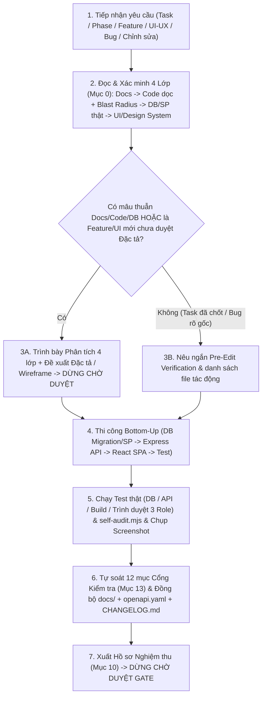

# 4. PROJECT-RULES.md — Quy ước Lập trình, Chống Suy Đoán, Bảo trì & Chuẩn mực Nền tảng v3.0

> **Dự án:** Hệ thống Quản lý Thiết bị CNTT (`QuanLyThietBiCNTT`) — Khung Nền tảng API Server & React SPA BVĐKKV Long Khánh  
> **Phiên bản:** 3.0 (**Lộ trình B**: Đồng bộ chuẩn kiến trúc `server/` Express 5 Modular API Server `/api/v1/*` + `client/` React/Vite/TypeScript 100% Offline LAN + Bộ UI/UX BVĐKKV Long Khánh; giữ nguyên 100% Hiến pháp Chống Suy Đoán 4 Lớp, 10 Điều Cấm, SOP 0/A/B/C/D, Nghiệm thu 4 thành phần & Bộ Prompt Mẫu)  
> **Cập nhật lần cuối:** 2026-11-20  
> **Xem thay đổi chi tiết tại:** `CHANGELOG.md` mục `[3.0.0-plan]`

> **Mục lục tra cứu nhanh:** [0. Chống Suy Đoán 4 Lớp](#0-nguyên-tắc-tối-thượng-cấm-suy-đoán--bắt-buộc-kiểm-tra-4-lớp-zero-assumption-policy) · [1–5. Quy chuẩn Backend/DB/Bảo mật/React UI](#1-quy-tắc-es-modules-server--typescript-client--bắt-buộc) · [6. 10 Điều Cấm AI](#6-giao-thức-làm-việc-bắt-buộc--các-hành-vi-bị-cấm-tuyệt-đối-với-ai-ai-working-protocol) · [10. Báo cáo Nghiệm thu](#10-quy-chuẩn-báo-cáo-nghiệm-thu-bắt-buộc-cho-từng-task--từng-giai-đoạn-acceptance-evidence-protocol) · [11. Quy trình từng bước cho AI (SOP 0/A/B/C/D)](#11-quy-trình-thực-thi-từng-bước-cho-ai-agent-theo-từng-loại-công-việc-ai-execution-workflows--sops) · [12. Chuẩn Bảo trì & Mở rộng Đa-WebApp](#12-chuẩn-bảo-trì-mở-rộng-đa-webapp--tiến-hóa-an-toàn-maintainability-clean-code--safe-evolution) · [13. Checklist 12 mục](#13-cổng-tự-kiểm-tra-bắt-buộc-trước-khi-báo-cáo-hoàn-thành-pre-delivery-self-audit-checklist) · [14. Bộ Prompt Mẫu Copy Nhanh](#14-bộ-prompt-mẫu-chuẩn-để-giao-việc--kiểm-soát-ai-agent-copy-paste-ready)

---

## 0. Nguyên tắc Tối thượng: Cấm Suy Đoán & Bắt buộc Kiểm tra 4 Lớp (Zero-Assumption Policy)

> **Áp dụng bắt buộc cho mọi AI Agent và lập trình viên** trước khi phân tích nguyên nhân lỗi, đề xuất phương án, sửa code, viết SQL, hay chỉnh sửa giao diện UI/UX.

### 0.1 Quy tắc số 0 — Cấm Suy Đoán (Zero-Guessing)
**Tuyệt đối KHÔNG ĐƯỢC đoán, suy diễn theo trí nhớ, hoặc giả định** bất kỳ thông tin nào sau đây khi chưa mở và đọc trực tiếp tệp/định nghĩa thực tế:
1. **Cơ sở dữ liệu:** tên bảng, tên cột, kiểu dữ liệu, độ dài cột, ràng buộc `NULL / NOT NULL`, `UNIQUE / CHECK / FK`, giá trị thực tế trong bảng, tên Stored Procedure, tên & kiểu tham số `@p...`, số lượng & thứ tự `recordsets[]` trả về.
2. **Backend API (`server/`):** đường dẫn `/api/v1/<domain>/<resource>`, thứ tự đăng ký Route/Middleware trong `server/src/app.js`, tên trường trong `req.validated`, cấu trúc JSON envelope `{ success, data, meta, error }`, mã lỗi `AppError`, chữ ký hàm trong `shared/` và `modules/`.
3. **Frontend React (`client/`):** đường dẫn component/feature, props của `design-system/`, TypeScript interfaces, React Query keys, route SPA, quyền hiển thị `<RequireRole>`, xử lý `import.meta.env.BASE_URL` và CSRF token.
4. **Nghiệp vụ:** quyền RBAC (`admin`/`technician`/`viewer`), quy tắc trạng thái, công thức báo cáo, hành vi xóa/hủy mềm, cấu hình `SystemSettings`.

### 0.2 Quy trình Kiểm tra 4 Lớp Bắt buộc trước khi Sửa (4-Layer Pre-Flight Inspection)
Trước khi viết hoặc sửa bất kỳ dòng code, SQL hay UI nào, bắt buộc đối chiếu tuần tự **đủ 4 lớp** liên quan đến phạm vi công việc:

| Lớp | Đối tượng bắt buộc phải đọc/kiểm tra | Mục đích |
|---|---|---|
| **Lớp 1 — Tài liệu chuẩn (`docs/`)** | Đọc các phần liên quan trong `PROJECT-RULES.md`, `PRD.md`, `ARCHITECTURE.md`, `DATA-SCHEMA.md`, `API-CONTRACTS.md`, `UI-DESIGN.md`, `AS-IS-BASELINE.md`, `IMPLEMENTATION-PLAN.md` và mục mới nhất của `CHANGELOG.md`. | Hiểu đúng yêu cầu nghiệp vụ, hợp đồng API `/api/v1/*`, Design System BVĐKKV Long Khánh và quyết định đã chốt. |
| **Lớp 2 — Mã nguồn thật (Chuỗi dọc)** | Mở đọc trực tiếp toàn bộ luồng từ đầu tới cuối: `server/src/app.js` → `modules/<domain>/<feature>/{routes,validators,controller,service}.js` → `shared/` → `client/src/shared/apiClient.ts` → `client/src/features/<feature>/*` → `client/src/design-system/*`. Tìm kiếm toàn dự án (`Select-String`/`grep`) mọi nơi tham chiếu (Blast Radius). | Xác minh 100% hành vi hiện tại và đo chính xác vùng ảnh hưởng để không gây lỗi dây chuyền. |
| **Lớp 3 — DB & Stored Procedure thật** | Đọc trực tiếp file migration (`db/sql/migrations/`), SP (`db/sql/procedures/`), bản xuất gốc (`db/sql/baseline/`). Nếu SP/bảng chưa đồng bộ ra file hoặc đang truy vết lỗi trên DEV → chạy truy vấn **chỉ đọc (`SELECT`)** trên catalog DB DEV (`sys.columns`, `sys.procedures`, `sys.sql_modules`, `sys.indexes`, `sys.foreign_keys`, `sys.check_constraints`). | Xác minh chính xác schema thật, tham số SP thật và dữ liệu biên thật — không bao giờ gọi SP khi chưa đọc thân SP. |
| **Lớp 4 — Giao diện & Design System (`client/`)** | Đọc `client/src/design-system/tokens.css`, `HospitalShell.tsx`, component dùng chung (`DataTable`, `FilterCard`, `Modal`, `StatusBadge`), feature page liên quan và đối chiếu `UI-DESIGN.md`. | Bảo đảm đúng bảng màu Y tế Long Khánh (`#00548F`/`#005A9C`/`#0B8A5C`), 0 CDN ngoài, đúng RBAC `<RequireRole>`, không phá vỡ layout hiện hữu. |

### 0.3 Thứ tự Ưu tiên Nguồn Sự thật & Cổng Dừng Hỏi (Stop-and-Ask Triggers)
- **Về hiện trạng đang chạy:** **DB thật / Mã nguồn thật** > `docs/AS-IS-BASELINE.md` > `project_context.md` (lịch sử).
- **Về thiết kế đích & chuẩn triển khai:** Bộ tài liệu `docs/*.md` v3.0 + `CHANGELOG.md` (`### Decisions`).
- **Bắt buộc DỪNG LẠI VÀ HỎI CHỦ DỰ ÁN** khi gặp 1 trong 6 tình huống: (1) Mâu thuẫn Docs vs Code/DB thật (trích dẫn `file:dòng` + SP/bảng), (2) Nghiệp vụ/RBAC chưa rõ, (3) Thay đổi bố cục UI/UX ngoài `UI-DESIGN.md`, (4) Thay đổi schema có rủi ro mất/biến đổi dữ liệu, (5) Cần thêm gói npm mới chưa có trong `ARCHITECTURE.md`, (6) Lỗi phát hiện ngoài phạm vi Task hiện tại.

### 0.4 Xác nhận Kiểm chứng trước khi Sửa (Pre-Edit Verification Note)
Trước khi sửa bất kỳ Bug-fix, Feature hay UI/UX nào, AI phải nêu ngắn gọn: (1) Các file đã đọc đủ 4 lớp, (2) Hợp đồng SP / API `/api/v1/*` / Component props thật đã xác minh, (3) Vùng ảnh hưởng (Blast Radius).

---

## 1. Quy tắc ES Modules (`server/`) & TypeScript (`client/`) — Bắt buộc

1. **Backend (`server/` — ES Modules `"type": "module"`):**
   - **Đuôi `.js` bắt buộc** trong mọi `import` nội bộ (`import apiResponse from '../../../shared/apiResponse.js';`).
   - **Export chuẩn:** Routes `export default router;`; Middleware/helper đơn lẻ `export default fn;`; Controllers & Services dùng Named Exports (`export async function ...`).
   - `__dirname` luôn khai báo từ `fileURLToPath(import.meta.url)`.
2. **Frontend (`client/` — React 19 + Vite + TypeScript `strict: true`):**
   - Cấm dùng `any` tùy tiện (dùng interface/type rõ ràng khớp với `API-CONTRACTS.md`).
   - Mọi component dùng chung cho đa-WebApp đặt trong `client/src/design-system/` và **tuyệt đối không import** bất kỳ file nào từ `client/src/features/`.
   - Chạy `npm run typecheck` (`tsc --noEmit`) và `npm run build` sạch `0` lỗi trước khi báo hoàn thành.

---

## 2. Quy tắc Phân tầng & Kiến trúc API Server (`server/`)

1. **Cô lập ranh giới Module (Modular Platform Boundary):**
   - `server/src/modules/core/` phục vụ `/api/v1/core/*` (Auth/SSO, Accounts, Departments, Users, Settings, AuditLogs, Healthz).
   - `server/src/modules/itam/` phục vụ `/api/v1/itam/*`. Các WebApp sau (`reports`, `helpdesk`...) đặt ở `server/src/modules/<appCode>/`.
   - **Cấm import chéo** giữa các domain module (`itam/` không import từ `<future-app>/` và ngược lại); chỉ được import từ `shared/` và `modules/core/`.
2. **Route (`*.routes.js`):** chỉ khai báo endpoint, gắn `requireAuth`, `requireRole`, `validate`, bọc controller bằng `asyncHandler`. Route tĩnh/sub-resource (`/dropdown`, `/export`, `/import/*`, `/summary`, `/reports/*`) **đặt trước** `/:id`.
3. **Controller (`*.controller.js`):** chỉ điều phối HTTP (`req.validated`, `req.params`, `req.session.user`); không viết `try/catch` lặp lại; không import `poolPromise`/`sql`; trả JSON qua `apiResponse` hoặc ném `new AppError(message, statusCode, code)`.
4. **Service (`*.service.js`):** mọi tham số SP dùng `.input('pName', sql.<DataType>, value)` khớp 100% `DATA-SCHEMA.md` và thân SP thật; tham số danh sách dùng `sql.Table` (TVP); gọi `auditLogService.log({ appCode, ... })` cho mọi thao tác ghi (lỗi ghi log không làm hỏng luồng chính, tuyệt đối không ghi mật khẩu/hash/token).
5. **Validation (`*.validators.js`) & OpenAPI:** mọi `POST/PUT/PATCH` (và query lọc quan trọng) đi qua `zod` vào `req.validated` (Express 5 không ghi đè `req.query`); cập nhật đồng bộ `server/docs/openapi.yaml`.

---

## 3. Quy tắc Database & Stored Procedure (SQL Server 2019 — compat `140`)

1. **Đặt tên SP:** SP mới theo chuẩn `sp_<Entity>_GetPaged / _GetById / _GetDropdown / _Create / _Update / _ToggleStatus / _Delete / _Cancel / _Transfer`. SP hiện hữu giữ nguyên tên để tương thích ngược Phase 1.
2. **Recordset phân trang:** SP mới và SP chuẩn hóa trả `recordsets[0] = data`, `recordsets[1] = [{ totalItems }]`.
3. **Khuôn đầu mỗi SP (bắt buộc):**
   ```sql
   SET ANSI_NULLS ON; SET QUOTED_IDENTIFIER ON;
   GO
   CREATE OR ALTER PROCEDURE dbo.sp_Entity_Action ...
   AS
   BEGIN
       SET NOCOUNT ON; SET XACT_ABORT ON;
       ...
   END
   ```
4. **Transaction:** thao tác nhiều bảng bọc trong `BEGIN TRY ... BEGIN TRANSACTION ... COMMIT ... END TRY BEGIN CATCH IF @@TRANCOUNT > 0 ROLLBACK; THROW; END CATCH`.
5. **Mã lỗi `THROW`:** `50001` → 400 `VALIDATION_ERROR`, `50004` → 404 `NOT_FOUND`, `50009` → 409 `BUSINESS_RULE_VIOLATION`, `50010` → 409 `CONCURRENT_MODIFICATION`.
6. **Chống ghi đè đồng thời:** `Devices`, `Repairs`, `DeviceAssignments` kiểm tra `@pRowVersion BINARY(8)` (`@pRowVersion IS NULL` = bỏ qua để giữ tương thích ngược ở Phase 1).
7. **Cấm hard-code ID/ngưỡng nghiệp vụ:** dùng `DeviceTypes.isPrinter` (không hard-code `1`), dùng `dbo.SystemSettings` cho mã Phòng CNTT (`it_department_code = 'PCNTT'`, không hard-code `deptId = 295`), tên người ký mặc định và ngưỡng cảnh báo bơm mực/bảo hành.
8. **Khoảng ngày:** `col >= @pStart AND col < DATEADD(DAY, 1, @pEnd)`.
9. **Tồn kho mực:** cập nhật tương đối `stockQuantity = stockQuantity + @delta` cùng 1 dòng `PrinterStockMovements` trong cùng transaction; hủy mềm qua `*_Cancel`.
10. **Không `ON DELETE CASCADE`:** SP xóa phải xóa bản ghi con tường minh trong cùng transaction.
11. **Quản lý phiên bản SQL:** bảng/index/seed nằm trong `db/sql/migrations/Vnnn__*.sql` (idempotent, ghi `SchemaVersions` + SHA-256, **cấm sửa migration đã chạy**); SP/View nằm trong `db/sql/procedures/*.sql` (`CREATE OR ALTER`). **Tuyệt đối không chạy DDL/DML trên Production.**
12. **Phân quyền DB & Mở rộng Schema:** `qltb_app` chỉ có `EXECUTE` trên `dbo` + CRUD riêng trên `dbo.Sessions`; không Dynamic SQL trong SP; WebApp tương lai tách schema riêng (vd `helpdesk.*`) hoặc DB riêng, không trộn vào bảng nghiệp vụ `itam`.

---

## 4. Quy tắc Bảo mật (Security Rules)

1. **Bí mật (`.env`):** toàn bộ cấu hình DB, `SESSION_SECRET`, `APP_BASE_PATH`, `LIBREOFFICE_PATH`, `COOKIE_SECURE`, `CORS_ORIGINS` đọc từ `.env`; không commit `.env`; `ecosystem.config.cjs` không chứa mật khẩu; tài liệu, script mẫu và `.env.example` tuyệt đối không ghi IP, mật khẩu hay tên login thật.
2. **Chống XSS trên React SPA:** cấm dùng `dangerouslySetInnerHTML` với dữ liệu từ người dùng/DB; cấm lưu mật khẩu, session hay auth token vào `localStorage`/`sessionStorage`; sử dụng mặc định JSX escaping của React.
3. **Cookie SSO & CSRF:** dùng cookie phiên `bv_lk.sid` (`httpOnly`, `sameSite=lax`, `path` theo `SESSION_COOKIE_PATH`, `secure` theo `COOKIE_SECURE`); `req.session.regenerate()` khi login; `destroy` khi logout; mọi `POST/PUT/PATCH/DELETE` gửi `X-CSRF-Token` lấy từ `GET /api/v1/core/auth/csrf` (lưu trong RAM JS).
4. **Đăng nhập & Mật khẩu:** thông báo thất bại luôn chung; khóa tạm 15 phút sau 5 lần sai; rate limit theo IP thật (`app.set('trust proxy', 1)`); `crypto.scrypt` + `timingSafeEqual`; mật khẩu ≥ 8 ký tự; `mustChangePassword = 1` cho tài khoản mới/reset.
5. **Helmet, CSP & CORS tường minh:** `default-src 'self'; script-src 'self'; style-src 'self' 'unsafe-inline'; font-src 'self' data:; img-src 'self' data:; frame-ancestors 'self'`; tắt `hsts`/`upgrade-insecure-requests` khi `COOKIE_SECURE=false` (HTTP LAN giai đoạn 1) và tự động bật khi chuyển sang HTTPS CA nội bộ (`COOKIE_SECURE=true`); CORS chỉ bật cho danh sách `CORS_ORIGINS` hợp lệ ở DEV (Production chạy Same-Origin sau IIS).
6. **Ẩn lỗi 500 & Chống CSV Injection:** không trả `err.stack` hay chi tiết SQL khi 500; xuất CSV qua `server/src/shared/csv.js` (BOM UTF-8 + thêm `'` trước `= + - @`, tab, xuống dòng).

---

## 5. Quy tắc Frontend React SPA, Design System BVĐKKV Long Khánh & IIS Sub-path

1. **100% Offline LAN (`0` CDN ngoài Internet):** toàn bộ Font tiếng Việt WOFF2 (`@fontsource`), SVG icons (`lucide-react`), CSS Tailwind, `qrcode` được Vite đóng gói hoàn toàn vào `client/dist/assets/`. **Cấm tuyệt đối** mọi URL Google Fonts, jsDelivr, unpkg, cdnjs trong `client/index.html`, CSS hay TSX.
2. **Tuân thủ tuyệt đối Design System (`UI-DESIGN.md` & `client/src/design-system/`):**
   - Dùng đúng bộ token màu nhận diện BVĐKKV Long Khánh (`--brand-sidebar-bg: #00548F`, `--brand-primary: #005A9C`, `--action-primary: #0B8A5C`, `--surface-canvas: #F4F7FA`, thẻ trắng bo `12px`).
   - Mọi trang nghiệp vụ bọc trong `<HospitalShell>` và dùng `<FilterCard>`, `<DataTable>` (header xanh `#005A9C`, sticky column, **empty/loading state căn giữa viewport**), `<Modal>`, `<SearchableSelect>`, `<StatusBadge>`, `<ConfirmDialog>`, `<RequireRole>`, `<PrintHeader>`.
3. **Tương thích IIS Sub-path (`VITE_BASE_PATH` / `APP_BASE_PATH`):**
   - Mọi đường dẫn API đi qua `client/src/shared/apiClient.ts` (tự ghép base path, tự gắn `credentials: 'include'` + `X-CSRF-Token`, tự xử lý `401`, `403 PASSWORD_CHANGE_REQUIRED`, `409 CONCURRENT_MODIFICATION`).
   - React Router khai báo `basename={import.meta.env.BASE_URL}`; mở PDF/CSV tab mới qua helper `buildApiUrl(...)`.
4. **Trải nghiệm mượt, RBAC & Chống bấm đúp:**
   - Ô tìm kiếm debounce `300 ms`; nút Lưu khóa ngay (`disabled` + spinner) khi mutation đang chạy (`isPending`); gắn `Idempotency-Key` cho Bulk Import CSV, Phiếu nhập mực và Nhật ký bơm mực.
   - Ẩn hoàn toàn nút/menu không đủ quyền bằng `<RequireRole>` (server luôn kiểm tra độc lập).
   - Hiển thị chuẩn Desktop `≥ 1366×768` không vỡ layout; màn hình quét QR (`/devices?profileId=<id>`) đọc gọn đẹp trên di động; định dạng ngày `dd/MM/yyyy`, tiền tệ `1.500.000 đ`.

---

## 6. Giao thức Làm việc Bắt buộc & 10 Hành vi bị CẤM Tuyệt đối với AI

### 6.1 Kỷ luật Thực thi Công việc
1. **Chỉ làm 1 phạm vi rõ ràng mỗi lượt:** Mỗi lần chỉ làm **1 Task** (hoặc 1 bug / 1 Phase được chủ dự án chỉ định rõ); mỗi Task = 1 commit Git rõ nghĩa (`T<ID>: <mô tả>`, `fix(<module>): ...`, `feat(<module>): ...`, `docs: ...`).
2. **Chỉ bắt đầu sửa code/DB khi chủ dự án yêu cầu rõ ràng.** Không sửa file ngoài phạm vi Task hoặc ngoài vùng ảnh hưởng đã xác minh.
3. **Tuân thủ bắt buộc Mục 0 (Kiểm tra 4 Lớp), Mục 11 (SOP theo loại việc) và Mục 13 (Cổng Tự Kiểm tra)** cho mọi yêu cầu.

### 6.2 Danh sách 10 Hành vi bị CẤM TUYỆT ĐỐI đối với AI (Hard Prohibitions)
1. **CẤM suy đoán** tên bảng, cột, SP, tham số SP, thứ tự `recordsets[]`, endpoint `/api/v1/*`, trường JSON hay component props khi chưa mở đọc file/DB thật.
2. **CẤM chạy bất kỳ lệnh DDL/DML nào lên DB Production (`QuanLyThietBiCNTT`)**; mọi migration & test chỉ chạy trên `QuanLyThietBiCNTT_DEV`.
3. **CẤM sửa đổi nội dung file migration `Vnnn__*.sql` đã chạy** (làm lệch SHA-256 `SchemaVersions`); thay đổi mới phải tạo `V(n+1)__*.sql`.
4. **CẤM tự ý cài thêm package npm mới hoặc chèn link CDN / Google Fonts ngoài Internet** khi chưa được chủ dự án phê duyệt.
5. **CẤM tự ý refactor lan rộng** ("tiện tay sửa luôn") các file, module, màn hình hay SP ngoài phạm vi Task/Bug hiện tại.
6. **CẤM làm gãy tương thích ngược DB/SP ở Phase 1** hoặc xóa/đổi tên cột/SP/API đang có caller dùng mà chưa qua chu trình Expand-Contract.
7. **CẤM "chữa triệu chứng" vòng vo** (như che lỗi SP/API bằng hack ở React, nuốt lỗi bằng `catch {}` rỗng, hay bỏ qua lỗi TypeScript bằng `@ts-ignore` / `as any`).
8. **CẤM ghi bí mật thật** (IP server, tên login SQL, mật khẩu, session secret) vào code, `ecosystem.config.cjs`, `.env.example`, `docs/`, `CHANGELOG.md` hay log.
9. **CẤM lưu token/session vào `localStorage`** hoặc dùng `dangerouslySetInnerHTML` với dữ liệu động chưa khử độc.
10. **CẤM báo "HOÀN TẤT"** khi chưa chạy kiểm thử thật, chưa chạy `self-audit.mjs`, chưa đính kèm output nguyên văn, chưa có ảnh chụp minh chứng (với UI/PDF), hoặc chưa cập nhật `docs/` & `CHANGELOG.md`.

---

## 7. Lưu ý riêng của Express 5 (`server/src/app.js`)

- `req.query`, `req.params` là getter chỉ đọc → đặt dữ liệu đã validate vào `req.validated`.
- Wildcard viết `/*splat`, tham số tùy chọn `{/:id}`.
- Thứ tự middleware chuẩn trong `server/src/app.js`: `trust proxy` → Helmet (CSP nội bộ) → Request Logger → CORS (chỉ DEV khi cấu hình) → BasePath Stripper → `express.json()` / `urlencoded` → Session (`MSSQLStore`) → CSRF → Routes `/api/v1/healthz` & `/api/v1/core/*` & `/api/v1/itam/*` → API 404 JSON (`/api/*splat`) → Static `client/dist/` → SPA Fallback (`GET /*splat` → `index.html`) → Global `errorHandler`.

---

## 8. Quy tắc Kiểm thử (Testing)

- **SP (`db/tests/`):** script `db/tests/<nhóm>.test.sql` chạy trên DEV với dữ liệu tạm và `ROLLBACK` cuối; kiểm nhánh thành công & lỗi (`50001/50004/50009/50010`).
- **API (`server/tests/`):** `node --test` kiểm đủ `200/201`, `400`, `401`, `403`, `404`, `409`, `429`.
- **Frontend (`client/`):** `npm run typecheck`, `npm run build` (0 lỗi), kiểm thử trực tiếp trên trình duyệt Desktop `≥ 1366px` (+ di động với QR 360°), đủ 3 vai trò (`viewer`/`technician`/`admin`), DevTools Console `0` lỗi & Network `0` CDN ngoài Internet.
- **Regression Test bắt buộc cho Bug-fix:** mọi lỗi đã sửa ở SP hoặc API đều phải bổ sung tối thiểu 1 test case tái hiện lỗi chống tái phát.

---

## 9. Quy tắc Tài liệu Sống & Nhật ký thay đổi (`CHANGELOG.md`)

1. **Tài liệu là Nguồn Sự thật sống (Living Documentation):** bất kỳ thay đổi nào về bảng/cột/SP, endpoint `/api/v1/*`, OpenAPI, quyền RBAC, `.env`/`SystemSettings`, hay màn hình/Design System đều phải cập nhật đồng bộ tài liệu tương ứng ngay trong cùng Task/phiên làm việc.
2. **Nhật ký `CHANGELOG.md`:** mọi lần sửa file trong `docs/` phải tăng version, cập nhật ngày và ghi 1 dòng vào `### Docs`:
   `- \`<TÊN-FILE>.md\` v<cũ> → v<mới> — mục <số/tiêu đề>: <đã sửa gì> — Lý do: <vì sao> — Ảnh hưởng: <Task/Module liên quan>`
3. **Quyết định thiết kế (`### Decisions`):** đánh số liên tiếp kèm lý do để mọi phiên sau nắm rõ ngữ cảnh.
4. **Cập nhật `AS-IS-BASELINE.md`:** sau mỗi Phase lớn (hoặc khi hoàn tất Cutover v3.0), cập nhật hiện trạng mới nhất.

---

## 10. Quy chuẩn Báo cáo Nghiệm thu Bắt buộc cho từng Task & từng Giai đoạn (Acceptance Evidence Protocol)

> **Nguyên tắc:** Không có bằng chứng kiểm chứng cụ thể = **CHƯA HOÀN TẤT**.

### 10.1 Hồ sơ Nghiệm thu cho TỪNG TASK NHỎ (`T<P>.<N>`)
Bắt buộc cung cấp đủ **4 thành phần**:
1. **Phạm vi thay đổi:** Danh sách file tạo/sửa (`git status --short` / `git diff --stat`) và mã commit.
2. **Script & Kết quả kiểm thử (Output thật nguyên văn):**
   - DB/SP: `db/tests/*.test.sql` + stdout/exit code + `rowCounts` trước/sau.
   - API: `node --test` + bảng mã HTTP (`200/201/400/401/403/404/409/429`).
   - React: `npm run typecheck` + `npm run build` + **`node .agents/skills/qltb-task-execution/scripts/self-audit.mjs --files "..."`** (`0` findings).
3. **Hình ảnh minh chứng (Screenshot — Bắt buộc với mọi Task có UI / PDF / In ấn):**
   - Giao diện đầy đủ `≥ 1366px` đúng nhận diện BVĐKKV Long Khánh, trạng thái có dữ liệu & trạng thái rỗng căn giữa, Modal Thêm/Sửa/360°/Import/QR, báo lỗi validation.
   - Minh chứng phân quyền ẩn/hiện nút đủ 3 vai trò (`viewer` vs `technician` vs `admin`).
   - DevTools tab **Console (`0` lỗi)** & tab **Network (`0` request CDN ngoài Internet)**.
   - Ảnh chụp PDF xem trước (Sửa chữa / Biên bản Bàn giao / Tem QR).
4. **Bảng Checklist Tiêu chí Nghiệm thu (`PASS / FAIL`):** Tick từng tiêu chí của Task trong `IMPLEMENTATION-PLAN.md`.

### 10.2 Báo cáo Nghiệm thu Tổng kết Giai đoạn (`docs/acceptance/PHASE-<N>-REPORT.md`)
Cuối mỗi Phase (`0 → 8`), tạo `docs/acceptance/PHASE-<N>-REPORT.md` tổng hợp bảng Task (`PASS/FAIL`), kết quả Smoke Test tích hợp, bộ ảnh lưu tại `docs/acceptance/images/phase-<N>/`, bảng đối chiếu `rowCounts` (NFR-06), và dòng xác nhận duyệt `🔒 GATE <N>` của chủ dự án.

---

## 11. Quy trình Thực thi Từng Bước cho AI Agent theo Từng Loại Công việc (AI Execution Workflows & SOPs)



### 11.0 SOP-0 — Thực thi từng Task & từng Giai đoạn trong `IMPLEMENTATION-PLAN.md`
- **Chu trình 6 bước mỗi Task (`T<P>.<N>`):** (1) Chốt phạm vi & tiền điều kiện trên `_DEV` → (2) Kiểm tra 4 Lớp + Pre-Edit Verification (dừng hỏi nếu gặp Mục 0.3) → (3) Thi công đúng thứ tự 4 tầng, không sửa lan ngoài Task → (4) Chạy test thật (DB/API/Build/Browser 3 vai trò) + `self-audit.mjs` + chụp screenshot → (5) Soát đủ 12 mục Mục 13 + commit `T<ID>: ...` → (6) Xuất Hồ sơ Nghiệm thu 4 thành phần (Mục 10.1).
- **Chốt Phase (`🔒 GATE <N>`):** Smoke Test tích hợp → đối chiếu `rowCounts` → tạo `docs/acceptance/PHASE-<N>-REPORT.md` + ảnh `images/phase-<N>/` → cập nhật `AS-IS-BASELINE.md` & `CHANGELOG.md` → **DỪNG CHỜ DUYỆT GATE**.

### 11.1 SOP-A — Quy trình Sửa lỗi (Bug-Fix Playbook)
1. Ghi nhận triệu chứng chính xác (URL, role, thao tác, HTTP status, Console/Network/Server log).
2. Truy vết đủ 4 lớp dọc (React feature/component → `apiClient` → Express route/validator/controller/service → thân SP thật → dữ liệu/constraint thật trên DEV chỉ đọc).
3. Báo cáo **Root Cause (`file:dòng`, SP/constraint)** + **Blast Radius** *(dừng hỏi nếu chạm schema/nghiệp vụ hoặc nhiều màn hình)*.
4. Sửa gọn đúng tầng gây lỗi + viết tối thiểu 1 **Regression Test**.
5. Chạy test + `self-audit.mjs` + chụp ảnh Trước/Sau (nếu có UI) + ghi `CHANGELOG.md` mục `### Fixed`.

### 11.2 SOP-B — Quy trình Thêm mới / Nâng cấp Chức năng (2 Nhịp có Cổng Duyệt)
- **Nhịp 1 (CHƯA CODE):** Khảo sát 4 lớp tìm phần tái sử dụng (`core/`, `shared/`, `design-system/`, `SystemSettings`) → đề xuất đặc tả (`PRD` → `ARCHITECTURE` → `DATA-SCHEMA` + `API-CONTRACTS` → `UI-DESIGN` wireframe + bảng quyền 3 vai trò + danh sách file/Blast Radius) → **⏸️ DỪNG CHỜ CHỦ DỰ ÁN DUYỆT**.
- **Nhịp 2 (SAU KHI DUYỆT):** Cập nhật đồng bộ `docs/` → Thi công Bottom-Up (DB DEV → `server/` + OpenAPI → `client/` 100% offline) → Test thật + `self-audit.mjs` + Screenshot 3 vai trò → Soát 12 mục Mục 13 → Cập nhật `AS-IS-BASELINE.md` & `CHANGELOG.md` → Hồ sơ Nghiệm thu 4 thành phần.

### 11.3 SOP-C — Quy trình Thiết kế & Thay đổi Giao diện UI/UX (2 Nhịp có Cổng Duyệt)
- **Nhịp 1 (CHƯA CODE với thay đổi bố cục/màn hình mới):** Đọc `UI-DESIGN.md`, `tokens.css`, `HospitalShell`, component `design-system/` và feature hiện tại → vẽ wireframe text + bảng quyền 3 vai trò → **⏸️ DỪNG CHỜ DUYỆT**.
- **Nhịp 2:** Code theo đúng Design System BVĐKKV Long Khánh (0 CDN, 0 Google Fonts, không `dangerouslySetInnerHTML`, không `localStorage` token, `<RequireRole>`, debounce 300ms, khóa nút khi gửi, empty state căn giữa, responsive ≥ 1366px + di động QR) → `typecheck` + `build` + `self-audit.mjs` → chụp ảnh Trước/Sau đủ 3 vai trò + DevTools Console/Network → đồng bộ `UI-DESIGN.md` & `CHANGELOG.md`.

### 11.4 SOP-D — Quy trình Chỉnh sửa khi Kết quả Chưa Đúng Ý (Refinement Playbook)
1. Mở lại trực tiếp code/SP/component vừa làm (không đoán theo trí nhớ), lập bảng 3 cột: **Hiện tại** | **Yêu cầu mới** | **File/SP gốc cần chỉnh**.
2. **Bảo toàn 100% phần đã `PASS`** — chỉ sửa đúng điểm lệch, không đập đi làm lại ngoài vùng sai.
3. Nếu thay đổi nghiệp vụ/API/UI so với đặc tả trước → cập nhật đồng bộ `docs/` & `CHANGELOG.md`.
4. Chạy lại test hồi quy + `self-audit.mjs` + chụp ảnh Trước/Sau (nếu có UI/PDF).

---

## 12. Chuẩn Bảo trì, Mở rộng Đa-WebApp & Tiến hóa An toàn (Maintainability, Clean Code & Safe Evolution)

### 12.1 Bản đồ Đặt tên & Cấu trúc Module 1-1
| Thành phần | Quy ước đường dẫn & tên file | Ghi chú |
|---|---|---|
| DB Migration | `db/sql/migrations/V<3 số>__<snake_case>.sql` | Bất biến sau khi đã chạy; idempotent. |
| Stored Procedure / View | `db/sql/procedures/<2 số>_sp_<nhom>.sql` | `CREATE OR ALTER`; gom theo nhóm nghiệp vụ. |
| SQL Test | `db/tests/<2 số>_<nhom>.test.sql` | Chạy trên DEV, kết thúc `ROLLBACK`. |
| API Feature Module | `server/src/modules/<domain>/<feature>/` (`routes`, `validators`, `controller`, `service`) | Domain: `core/`, `itam/`, `<future-app>/`. |
| API Spec & Test | `server/docs/openapi.yaml` & `server/tests/<domain>/<feature>.test.js` | Chạy bằng `node --test`. |
| Reusable UI Kit | `client/src/design-system/{layout,components}/<PascalCase>.tsx` | **0 phụ thuộc nghiệp vụ `itam`**, dùng chung mọi WebApp. |
| React Feature Module | `client/src/features/<feature>/{<Name>Page.tsx, api.ts, types.ts, components/*}` | Tách gọn trang, hook query, schema form và Modal con. |

### 12.2 Chuẩn Mã nguồn Sạch & Chống Phình to (Clean Code & DRY)
1. **Single Source of Truth:** Backend dùng chung `server/src/shared/` & `modules/core/`; Frontend dùng chung `client/src/design-system/` & `client/src/shared/` (`apiClient`, `formatters`, `qrLabel`). **Cấm copy-paste** logic định dạng ngày/tiền, xử lý lỗi API hay component bảng/modal lặp lại giữa các feature.
2. **Ngưỡng tách hàm/component:** Hàm nghiệp vụ > 60–80 dòng hoặc component React > 250–300 dòng (gộp bảng + nhiều Modal trong 1 file) phải tách thành component/hook con rõ trách nhiệm.
3. **Cấm magic numbers/strings & cấm nuốt lỗi:** dùng hằng số/enum TypeScript & JS đồng nhất với SQL; thông số thay đổi theo thời gian đọc từ `SystemSettings` hoặc `.env`; không viết `catch {}` rỗng hay `@ts-ignore`.
4. **Comment đúng chỗ:** viết comment giải thích **"tại sao" (Why)** cho bất biến nghiệp vụ (thứ tự ưu tiên trạng thái, thuật toán diff gắn/gỡ linh kiện, `UPDLOCK/HOLDLOCK`, cơ chế mở rộng đa-WebApp).

### 12.3 Tiến hóa Tương thích ngược (Expand → Migrate → Verify → Contract)
- **DB:** Thêm cột mới `NULL`/default hoặc schema mới cho WebApp mới (`helpdesk.*`) trước; chỉ dọn cột/SP cũ ở phiên bản sau khi chứng minh `0` caller.
- **SP:** Tham số mới đặt cuối có default (`= NULL`); cột mới thêm cuối `SELECT`.
- **API:** Giữ nguyên `/api/v1/*` tương thích ngược (chỉ thêm trường mở rộng); thay đổi phá vỡ phải tăng lên `/api/v2/*`.
- **Rollback:** Gắn Git tag `pre-v3.0`, sao lưu toàn phần DB trước `--prod --backup-confirmed`, tách riêng migration và SP.

### 12.4 Quản trị Cấu hình & Thư viện Phụ thuộc
- Mọi biến `.env` mới phải đồng thời cập nhật `.env.example` (không bí mật thật), `server/src/config/env.js` (fail-fast) và `ARCHITECTURE.md`.
- Chỉ thêm gói `npm` (ở `server/` hoặc `client/`) khi thật sự cần và **được chủ dự án duyệt**; giữ `package-lock.json` đồng bộ; kiểm tra `npm audit` sạch `high/critical`.

---

## 13. Cổng Tự Kiểm tra Bắt buộc trước khi Báo cáo Hoàn thành (Pre-Delivery Self-Audit Checklist)

- [ ] **1. Đã đọc đủ 4 lớp (Không suy đoán):** đã kiểm tra trực tiếp Tài liệu (`docs/`) + Code dọc (`server/` & `client/`) + SP/Schema thật + Design System trước khi sửa.
- [ ] **2. Đúng phạm vi & Blast Radius an toàn:** không sửa file ngoài phạm vi; đã tìm toàn dự án mọi caller/component/SP dùng chung.
- [ ] **3. An toàn Production & Migration:** tuyệt đối không đụng DB Production; không sửa migration cũ đã chạy; migration mới idempotent & có test `ROLLBACK`.
- [ ] **4. Chuẩn SQL & Tương thích ngược:** SP đủ `SET ANSI_NULLS/QUOTED_IDENTIFIER/NOCOUNT/XACT_ABORT`, transaction + `THROW` (`50001/50004/50009/50010`), không `ON DELETE CASCADE`, không Dynamic SQL, không hard-code ID/ngưỡng.
- [ ] **5. Chuẩn API Server (`server/`):** ESM đuôi `.js`, không import chéo domain, Controller mỏng, `zod` → `req.validated`, `auditLogService.log` có `appCode`, cập nhật `openapi.yaml`.
- [ ] **6. Chuẩn Bảo mật & Bí mật:** `requireAuth`, `requireRole`, Cookie `HttpOnly` + CSRF, không `localStorage` token, không `dangerouslySetInnerHTML`, chống CSV Injection, **0 IP/mật khẩu/login thật**.
- [ ] **7. Chuẩn React SPA, Design System & Offline LAN:** 100% tài nguyên đóng gói nội bộ (`0` CDN, `0` Google Fonts), đúng màu BVĐKKV Long Khánh (`#00548F`/`#005A9C`/`#0B8A5C`), dùng `design-system/` (không import từ `features/`), tương thích `VITE_BASE_PATH`, `<RequireRole>` đủ 3 vai trò, `tsc --noEmit` & `vite build` sạch `0` lỗi.
- [ ] **8. Chuẩn Bảo trì & Sạch mã (DRY):** không copy-paste helper/UI, không magic numbers, không `@ts-ignore`/`as any` bừa bãi, đúng bản đồ đặt tên Mục 12.1.
- [ ] **9. Kiểm thử thật & Automated Self-Audit:** đã chạy test DB/API/Regression + **`node .agents/skills/qltb-task-execution/scripts/self-audit.mjs`** (`0` findings) kèm **output nguyên văn**.
- [ ] **10. Kiểm thử Trình duyệt & Screenshot (với UI/PDF):** DevTools Console `0` lỗi, Network `0` CDN ngoài, đủ ảnh chụp giao diện / 3 vai trò / PDF theo Mục 10.1.
- [ ] **11. Đồng bộ Tài liệu & `CHANGELOG.md`:** đã cập nhật `docs/*.md` bị ảnh hưởng và ghi đầy đủ vào `CHANGELOG.md` theo Mục 9.
- [ ] **12. Báo cáo Nghiệm thu đầy đủ:** đủ 4 thành phần nghiệm thu (file diff, script + output thật, screenshot nếu có UI/PDF, bảng `PASS/FAIL`).

---

## 14. Bộ Prompt Mẫu Chuẩn để Giao việc & Kiểm soát AI Agent (Copy-Paste Ready)

> **Cơ chế tự động kích hoạt (`AGENTS.md` + 5 Workspace Skills v3.0):**
> - File **`AGENTS.md`** tại gốc dự án tự động nạp 100% ở mọi phiên chat mới.
> - Bộ 5 Workspace Skills tại **`.agents/skills/`**: `qltb-task-execution` (+ `scripts/self-audit.mjs`), `qltb-mssql-sp-migration`, `qltb-express5-api`, `qltb-react-ui-verify`, `qltb-bugfix-refinement`.
> - Copy đúng mẫu dưới đây và điền vào các ngoặc vuông `[...]`.

### 14.1 Prompt Mẫu — Thực hiện Kế hoạch trong `IMPLEMENTATION-PLAN.md`

#### Mẫu 1A — Giao thực hiện 1 Task nhỏ (`T<P>.<N>`)
```text
Áp dụng skill qltb-task-execution (kết hợp skill chuyên tầng: qltb-mssql-sp-migration / qltb-express5-api / qltb-react-ui-verify) và tuân thủ AGENTS.md + docs/PROJECT-RULES.md, hãy thực hiện ĐÚNG 1 TASK trong docs/IMPLEMENTATION-PLAN.md: [T<P>.<N> — Ví dụ: T0.3 / T1.3 / T2.6].

Yêu cầu bắt buộc:
1. Kiểm tra đủ 4 lớp (Docs chỉ định -> Code dọc server/ & client/ + Blast Radius -> DB/SP thật trên DEV hoặc db/sql/ -> Design System hiện hữu) trước khi sửa — cấm suy đoán. Gặp mâu thuẫn (Mục 0.3) -> DỪNG HỎI ngay.
2. Tuyệt đối KHÔNG đụng DB Production (QuanLyThietBiCNTT); mọi migration & test chỉ chạy trên QuanLyThietBiCNTT_DEV.
3. Sửa gọn đúng phạm vi Task, chạy kiểm thử thật (DB/API/typecheck/build) + chạy self-audit.mjs trên các file vừa tạo/sửa.
4. Tự kiểm đủ 12/12 mục (Mục 13) và xuất Hồ sơ Nghiệm thu 4 thành phần (Mục 10.1): file diff, script + output nguyên văn (kèm output self-audit.mjs), ảnh chụp minh chứng (nếu có UI/PDF: >= 1366px đúng màu BVĐKKV Long Khánh, 3 role, Console 0 lỗi, Network 0 CDN), bảng Checklist PASS/FAIL.
5. Xong Task này thì DỪNG CHỜ tôi nghiệm thu, KHÔNG tự làm sang Task tiếp theo.
```

#### Mẫu 1B — Giao thực hiện trọn 1 Giai đoạn (`Phase <N>`) có Cổng Duyệt (`🔒 GATE`)
```text
Áp dụng skill qltb-task-execution (kết hợp qltb-mssql-sp-migration / qltb-express5-api / qltb-react-ui-verify theo từng tầng) và tuân thủ AGENTS.md + docs/PROJECT-RULES.md, hãy triển khai trọn Giai đoạn: [Phase <N> — Ví dụ: Phase 1A / Phase 2A / Phase 2B / Phase 5] trong docs/IMPLEMENTATION-PLAN.md.

Kỷ luật thực thi bắt buộc:
1. Thực hiện tuần tự từng Task nhỏ trong [Phase <N>] theo đúng SOP-0 (Mục 11.0), KHÔNG gộp ẩu và KHÔNG bỏ qua bước đọc 4 lớp hay kiểm thử từng Task.
2. Tuyệt đối KHÔNG đụng DB Production; chỉ thao tác trên QuanLyThietBiCNTT_DEV; giữ ranh giới module (core/ vs itam/, design-system/ vs features/) và không tự ý cài thêm package/CDN mới. Gặp mâu thuẫn (Mục 0.3) -> DỪNG HỎI ngay.
3. Cuối [Phase <N>]:
   - Chạy Smoke Test tích hợp toàn Phase, typecheck/build (nếu chạm client/), self-audit.mjs và đối chiếu số dòng DB trước/sau (NFR-06).
   - Tạo báo cáo docs/acceptance/PHASE-<N>-REPORT.md kèm ảnh chụp lưu tại docs/acceptance/images/phase-<N>/ (nếu có UI/PDF).
   - Cập nhật docs/AS-IS-BASELINE.md (nếu thêm bảng/SP/endpoint/màn hình mới) và CHANGELOG.md.
4. Tự soát 12 mục (Mục 13) rồi DỪNG BẮT BUỘC TẠI 🔒 GATE <N> chờ tôi duyệt, KHÔNG tự chạy sang Phase tiếp theo.
```

---

### 14.2 Prompt Mẫu — Thêm mới / Nâng cấp Chức năng & Giao diện UI/UX (2 Nhịp có Cổng Duyệt)

```text
Tôi muốn [THÊM MỚI / NÂNG CẤP] chức năng / WebApp / giao diện sau trên nền tảng BVĐKKV Long Khánh (QuanLyThietBiCNTT v3.0):
- Thuộc dự án / module: [itam (QLTB CNTT) / core (dùng chung) / module mới: <tên app>]
- Tên chức năng / Màn hình: [Ví dụ: Báo cáo chi phí sửa chữa theo Khoa / Thêm màn hình Sổ CĐHA]
- Mục tiêu nghiệp vụ: [Mô tả rõ cần giải quyết vấn đề gì trong bệnh viện]
- Phân quyền vai trò (RBAC): [admin: ... | technician: ... | viewer: ...]
- Yêu cầu giao diện UI/UX mong muốn: [Mô tả vị trí menu, bộ lọc, cột bảng, Modal, nút In/Xuất Excel, hoặc đính kèm ảnh]
- Lưu ý / Ràng buộc thêm (nếu có): [Ví dụ: tái sử dụng HospitalShell + FilterCard + DataTable...]

BẮT BUỘC áp dụng AGENTS.md + docs/PROJECT-RULES.md (Mục 0, 11.2 SOP-B, 11.3 SOP-C, 12, 13) và các skill qltb-mssql-sp-migration, qltb-express5-api, qltb-react-ui-verify theo ĐÚNG 2 NHỊP:

=== NHỊP 1: KHẢO SÁT 4 LỚP & CHỐT ĐẶC TẢ (CHƯA ĐƯỢC SỬA CODE HAY DB) ===
1. Đọc trực tiếp đủ 4 lớp (docs/ + code dọc server/ & client/ + DB/SP thật trên DEV/db/sql + design-system/ hiện hữu). Cấm suy đoán.
2. Chỉ rõ bảng, SP, dịch vụ core/shared và component design-system/ nào tái sử dụng được để tránh viết trùng.
3. Đề xuất phương án chi tiết gồm: thay đổi DB (migration Vnnn + SP / schema riêng nếu là app mới), hợp đồng API /api/v1/* + OpenAPI + audit log, wireframe text theo chuẩn màu BVĐKKV Long Khánh + bảng quyền 3 vai trò, danh sách file tạo/sửa + Blast Radius, và câu hỏi cần tôi chốt (nếu có).
4. DỪNG LẠI sau Nhịp 1 chờ tôi duyệt.

=== NHỊP 2 (CHỈ THỰC HIỆN SAU KHI TÔI TRẢ LỜI "DUYỆT NHỊP 1"): ===
- Cập nhật đồng bộ docs/ (PRD, ARCHITECTURE, DATA-SCHEMA, API-CONTRACTS, UI-DESIGN) -> Thi công Bottom-Up (DB DEV -> server/ + openapi.yaml -> client/ 100% offline) -> Chạy test thật + typecheck/build + self-audit.mjs + chụp ảnh đủ 3 role & DevTools Console/Network -> Soát 12 mục Mục 13 -> Cập nhật AS-IS-BASELINE.md & CHANGELOG.md -> Báo cáo nghiệm thu 4 thành phần (Mục 10.1).
```

---

### 14.3 Prompt Mẫu — Sửa lỗi (Bug-Fix theo SOP-A)

```text
Áp dụng skill qltb-bugfix-refinement (chế độ SOP-A) và AGENTS.md + docs/PROJECT-RULES.md để kiểm tra và sửa lỗi sau:
- Màn hình / URL / API gặp lỗi: [Ví dụ: /devices -> gọi PUT /api/v1/itam/devices/12]
- Tài khoản / Vai trò đang dùng: [admin / technician / viewer]
- Các bước tái hiện: [Bước 1 -> Bước 2 -> Bước 3]
- Hiện tượng thực tế / Mã lỗi / Log / Ảnh chụp: [Dán lỗi Console, HTTP status, Server log hoặc đính kèm ảnh]
- Kết quả đúng mong muốn: [Mô tả rõ hành vi đúng]

Yêu cầu bắt buộc:
1. CẤM suy đoán. Truy vết đủ 4 lớp dọc (React feature/component -> apiClient -> Express route/validator/controller/service -> thân SP thật -> dữ liệu/constraint thật trên DEV chỉ đọc).
2. Nêu rõ Nguyên nhân gốc (Root Cause kèm file:dòng, tên SP/constraint) và Vùng ảnh hưởng (Blast Radius). *(Nếu chạm schema/nghiệp vụ hoặc nhiều màn hình -> DỪNG trình chẩn đoán chờ tôi duyệt trước khi sửa.)*
3. Sửa gọn đúng tầng gây lỗi + viết tối thiểu 1 Regression Test chống tái phát.
4. Chạy test thật + typecheck/build (nếu chạm client/) + self-audit.mjs (output nguyên văn) + chụp ảnh Trước/Sau trên trình duyệt (Console 0 lỗi, Network 0 CDN nếu có UI).
5. Soát 12 mục (Mục 13) và ghi rõ vào CHANGELOG.md mục Fixed (cập nhật docs/ nếu đổi hợp đồng/quy tắc).
```

---

### 14.4 Prompt Mẫu — Yêu cầu Chỉnh sửa khi Kết quả Chưa Đúng Ý (Refinement theo SOP-D)

```text
Áp dụng skill qltb-bugfix-refinement (chế độ SOP-D, kết hợp qltb-react-ui-verify nếu liên quan UI) và AGENTS.md + docs/PROJECT-RULES.md để tinh chỉnh các điểm CHƯA ĐÚNG Ý ở [Task / Màn hình / Chức năng vừa làm]:

Các điểm chưa đúng ý cần sửa:
1. [Điểm 1]: Hiện tại đang là [...] -> Tôi muốn sửa thành [...]
2. [Điểm 2]: Hiện tại đang là [...] -> Tôi muốn sửa thành [...]
3. [Điểm 3 (nếu có)]: [...]

Phần đã ổn (GIỮ NGUYÊN, KHÔNG sửa làm hỏng):
- [Ví dụ: API lưu dữ liệu và phân quyền ẩn nút cho viewer đã ổn, giữ nguyên]

Ảnh chụp / vị trí minh họa (nếu có): [Đính kèm ảnh hoặc chỉ rõ cột/nút/Modal]

Yêu cầu bắt buộc:
1. Đọc lại trực tiếp file/SP/component gốc (không nhớ mang máng), lập bảng đối chiếu 3 cột: [Hiện tại] | [Yêu cầu mới] | [File/SP gốc cần chỉnh].
2. Chỉ sửa tối thiểu đúng điểm lệch; tuyệt đối không đập đi làm lại phần đã PASS và không gây hồi quy cho vai trò/chức năng khác.
3. Nếu thay đổi nghiệp vụ, API hoặc bố cục so với đặc tả trước -> cập nhật đồng bộ docs/ và CHANGELOG.md.
4. Chạy lại test + typecheck/build + self-audit.mjs (output nguyên văn) + chụp ảnh Trước/Sau (nếu là UI/PDF) và soát 12 mục (Mục 13).
```

---

### 14.5 Prompt Mẫu — Duyệt Cổng Nghiệm thu (`🔒 GATE`) & Mở Giai đoạn Tiếp theo

```text
Tôi đã xem docs/acceptance/PHASE-<N>-REPORT.md và xác nhận DUYỆT 🔒 GATE <N> (PASS).
[Ghi chú thêm nếu có, hoặc xóa dòng này].

Hãy áp dụng skill qltb-task-execution (cùng các skill chuyên tầng tương ứng) và AGENTS.md để triển khai [Task T<P>.<M> HOẶC Phase <K>] trong docs/IMPLEMENTATION-PLAN.md.
Tiếp tục chỉ làm trên QuanLyThietBiCNTT_DEV, chạy đầy đủ test + typecheck/build + self-audit.mjs + screenshot (nếu có UI/PDF) và DỪNG chờ duyệt khi xong [Task / 🔒 GATE <K>].
```
